# AMAALPROP — Entity Relationship Diagram (ERD)
**Version:** 1.0  
**Date:** 13 November 2026  
**Status:** Proposed logical data model for technical design

---

## 1. Purpose and modelling principles

AMAALPROP is a multi-organisation property-management SaaS. Each property organisation operates in an isolated tenant space and manages its own properties, staff, occupants, leases, billing, payments, accounting, maintenance and clearance workflows.

This ERD translates the agreed product rules into a relational model. It is a logical design: implementation-specific types, indexes, partitioning and security policies should be finalised against the selected database engine.

### Confirmed business rules

1. **One property organisation has one landlord/owner account.** The organisation has one designated owner. Staff and delegated administrators are not co-owners.
2. **One email address can belong to only one property organisation.** Enforce this globally for organisation-linked login identities. A person who works for more than one organisation must use a separate email identity for each organisation under this rule.
3. **A tenant can rent more than one property/unit**, including multiple units in the same building.
4. **A unit's occupancy arrangement is configurable before tenant registration/lease creation.** A unit can be single-occupant or shared, with a configured maximum number of tenant parties/persons. Actual lease participants must not exceed the configured limit.
5. **Co-tenancy is explicit.** A lease can have one or multiple tenant parties. One tenant party can be associated with multiple leases/units.
6. **Payment instructions are configured by the landlord organisation**, optionally overridden at portfolio/property/building/unit/lease scope. Tenants pay externally and submit payment references. An authorised staff member verifies the submission before it becomes a posted receipt/payment.
7. **Accounting is full double-entry accounting.** Every posted financial transaction creates balanced journal entries. Posted entries are immutable; corrections use reversal and replacement entries.
8. **Tenant portal activation requires an invitation and approval by the landlord or an authorised manager.**
9. **Tenant exit clearance follows:** caretaker inspection → property manager verification → landlord or delegated authority final approval. Approval authority is configurable through policy.
10. **Employee hierarchy is configurable.** Roles, permissions, reporting relationships and property/location assignments are separate concepts.
11. A tenant's **financial standing** and **physical/property-condition clearance** are separate statuses.
12. A property may be standalone or contain buildings, levels and units. Do not force artificial building or floor records for standalone premises.

---

## 2. ERD notation

- `PK`: primary key.
- `FK`: foreign key.
- `UQ`: unique constraint.
- `NN`: not null.
- `?`: nullable.
- `1 ───< many`: one-to-many.
- `>───<`: many-to-many, resolved through a junction table.
- IDs are UUIDs unless the implementation chooses another opaque identifier.
- All organisation-owned records carry `organisation_id` directly or are reachable through a parent that carries it. For security-critical tables, direct `organisation_id` is recommended to support row-level security and composite foreign keys.

---

## 3. Core entity relationship diagram

```mermaid
erDiagram
    PROPERTY_ORGANISATION ||--|| ORGANISATION_OWNER : has
    PROPERTY_ORGANISATION ||--o{ USER_ACCOUNT : has_login
    PROPERTY_ORGANISATION ||--o{ ORGANISATION_MEMBERSHIP : grants
    USER_ACCOUNT ||--o{ ORGANISATION_MEMBERSHIP : belongs_through
    PROPERTY_ORGANISATION ||--o{ ROLE : defines
    ROLE ||--o{ ROLE_PERMISSION : contains
    PERMISSION ||--o{ ROLE_PERMISSION : assigned
    ORGANISATION_MEMBERSHIP ||--o{ USER_ROLE_ASSIGNMENT : receives
    ROLE ||--o{ USER_ROLE_ASSIGNMENT : assigned_as
    ORGANISATION_MEMBERSHIP ||--o{ REPORTING_RELATIONSHIP : reports_in
    ORGANISATION_MEMBERSHIP ||--o{ REPORTING_RELATIONSHIP : supervises
    ORGANISATION_MEMBERSHIP ||--o{ SCOPE_ASSIGNMENT : scoped_to

    PROPERTY_ORGANISATION ||--o{ PORTFOLIO : owns
    PORTFOLIO ||--o{ PROPERTY : groups
    PROPERTY_ORGANISATION ||--o{ PROPERTY : manages
    PROPERTY ||--o{ BUILDING : contains
    PROPERTY ||--o{ PROPERTY_LEVEL : contains_level
    BUILDING ||--o{ PROPERTY_LEVEL : has_level
    PROPERTY ||--o{ RENTABLE_UNIT : contains_unit
    BUILDING ||--o{ RENTABLE_UNIT : contains_unit
    PROPERTY_LEVEL ||--o{ RENTABLE_UNIT : contains_unit
    UNIT_TYPE ||--o{ RENTABLE_UNIT : classifies
    RENTABLE_UNIT ||--o{ UNIT_OCCUPANCY_POLICY : has_policy

    PROPERTY_ORGANISATION ||--o{ TENANT_PARTY : registers
    TENANT_PARTY ||--o{ TENANT_PERSON : includes
    TENANT_PERSON ||--o| USER_ACCOUNT : may_login_as
    TENANT_PARTY ||--o{ TENANT_DOCUMENT : has
    TENANT_PARTY ||--o{ TENANT_CONTACT : has

    RENTABLE_UNIT ||--o{ LEASE : leased_under
    PROPERTY_ORGANISATION ||--o{ LEASE : manages
    LEASE ||--o{ LEASE_PARTICIPANT : includes
    TENANT_PARTY ||--o{ LEASE_PARTICIPANT : participates
    LEASE ||--o{ LEASE_UNIT : covers
    RENTABLE_UNIT ||--o{ LEASE_UNIT : included_in
    LEASE ||--o{ LEASE_CHARGE_RULE : defines
    LEASE ||--o{ LEASE_DOCUMENT : stores
    LEASE ||--o{ LEASE_EVENT : records

    PROPERTY_ORGANISATION ||--o{ PAYMENT_INSTRUCTION : configures
    PAYMENT_INSTRUCTION ||--o{ PAYMENT_INSTRUCTION_SCOPE : applies_at
    LEASE ||--o{ INVOICE : billed_by
    INVOICE ||--o{ INVOICE_LINE : contains
    TENANT_PARTY ||--o{ INVOICE : billed_to
    INVOICE ||--o{ PAYMENT_ALLOCATION : settled_by
    PAYMENT ||--o{ PAYMENT_ALLOCATION : allocated
    PAYMENT_SUBMISSION ||--o| PAYMENT : verified_into
    TENANT_PARTY ||--o{ PAYMENT_SUBMISSION : submits
    LEASE ||--o{ PAYMENT_SUBMISSION : relates_to
    PAYMENT_INSTRUCTION ||--o{ PAYMENT_SUBMISSION : references

    PROPERTY_ORGANISATION ||--|| ACCOUNTING_PERIOD : controls
    PROPERTY_ORGANISATION ||--o{ ACCOUNT : owns_chart
    ACCOUNT ||--o{ JOURNAL_LINE : receives
    JOURNAL_ENTRY ||--|{ JOURNAL_LINE : contains
    PROPERTY_ORGANISATION ||--o{ JOURNAL_ENTRY : posts
    JOURNAL_ENTRY ||--o{ JOURNAL_REVERSAL_LINK : reversed_by
    JOURNAL_ENTRY ||--o{ JOURNAL_REVERSAL_LINK : reverses
    PAYMENT ||--o| JOURNAL_ENTRY : posts_to
    INVOICE ||--o| JOURNAL_ENTRY : posts_to
    EXPENSE ||--o| JOURNAL_ENTRY : posts_to

    PROPERTY_ORGANISATION ||--o{ MAINTENANCE_REQUEST : receives
    RENTABLE_UNIT ||--o{ MAINTENANCE_REQUEST : concerns
    TENANT_PARTY ||--o{ MAINTENANCE_REQUEST : raises
    MAINTENANCE_REQUEST ||--o{ WORK_ORDER : creates
    WORK_ORDER ||--o{ WORK_ORDER_EVENT : tracks

    LEASE ||--o| MOVE_OUT_REQUEST : may_have
    MOVE_OUT_REQUEST ||--o{ INSPECTION : triggers
    INSPECTION ||--|{ INSPECTION_ITEM : checks
    INSPECTION ||--o{ INSPECTION_EVIDENCE : supported_by
    MOVE_OUT_REQUEST ||--o{ CLEARANCE_STEP : requires
    CLEARANCE_STEP ||--o{ CLEARANCE_DECISION : decided_by
    LEASE ||--o{ DEPOSIT_TRANSACTION : tracks

    PROPERTY_ORGANISATION ||--o{ NOTIFICATION : sends
    USER_ACCOUNT ||--o{ NOTIFICATION : receives
    PROPERTY_ORGANISATION ||--o{ AUDIT_EVENT : audits
    USER_ACCOUNT ||--o{ AUDIT_EVENT : performs
```

> Mermaid ER diagrams have limited support for optionality and composite constraints. The detailed table definitions below are authoritative where the diagram is simplified.

---

## 4. Identity, organisation and access-control data model

### 4.1 `property_organisations`

Represents one independent landlord/property-management business using AMAALPROP.

| Field | Type | Rules | Description |
|---|---|---|---|
| `id` | UUID | PK | Organisation identifier |
| `legal_name` | VARCHAR(200) | NN | Registered/legal name |
| `display_name` | VARCHAR(160) | NN | Name displayed in the application |
| `registration_number` | VARCHAR(100) | nullable | Business registration number |
| `tax_identifier` | VARCHAR(100) | nullable, encrypted where appropriate | Tax registration identifier |
| `country_code` | CHAR(2) | NN | ISO country code |
| `default_currency` | CHAR(3) | NN | ISO 4217 currency, e.g. UGX |
| `timezone` | VARCHAR(64) | NN | IANA timezone, e.g. Africa/Kampala |
| `business_email` | VARCHAR(254) | nullable | Public organisation email; not a login identity |
| `business_phone` | VARCHAR(40) | nullable | Organisation contact |
| `postal_address` | TEXT | nullable | Postal address |
| `status` | ENUM | NN | `pending`, `active`, `suspended`, `closed` |
| `created_at` | TIMESTAMP | NN | Creation time |
| `updated_at` | TIMESTAMP | NN | Last update |

### 4.2 `organisation_owners`

Enforces one designated owner per organisation.

| Field | Type | Rules | Description |
|---|---|---|---|
| `id` | UUID | PK | Record ID |
| `organisation_id` | UUID | FK, UQ, NN | One owner record per organisation |
| `user_account_id` | UUID | FK, UQ, NN | Designated owner login |
| `appointed_at` | TIMESTAMP | NN | Ownership designation time |
| `appointed_by_user_id` | UUID | nullable FK | System/bootstrap actor or authorised transfer actor |
| `status` | ENUM | NN | `active`, `superseded` |

**Constraint:** one active owner per organisation. A change of owner must be a controlled ownership-transfer workflow, audited and confirmed. Do not model multiple property co-owners in this table. If beneficial ownership is ever needed for legal reporting, add a separate non-login ownership-interest model without changing the one-accountable-landlord rule.

### 4.3 `user_accounts`

A login identity. Tenant-person and employee profiles are separate from authentication credentials.

| Field | Type | Rules | Description |
|---|---|---|---|
| `id` | UUID | PK | User identity |
| `email` | VARCHAR(254) | NN, globally UQ, normalised lowercase | Login email |
| `email_verified_at` | TIMESTAMP | nullable | Email verification |
| `phone_e164` | VARCHAR(20) | nullable | Phone in E.164 format |
| `phone_verified_at` | TIMESTAMP | nullable | Phone verification |
| `password_hash` | TEXT | nullable | Store only a strong password hash; support external identity provider later |
| `account_status` | ENUM | NN | `invited`, `pending_approval`, `active`, `suspended`, `disabled` |
| `last_login_at` | TIMESTAMP | nullable | Last login |
| `created_at` | TIMESTAMP | NN | Created |
| `updated_at` | TIMESTAMP | NN | Updated |

**Email rule:** `UNIQUE(normalised_email)` across the entire platform, not merely within one organisation. An email cannot be used by two organisation identities. Public contact emails on organisation/property records are not login emails and do not participate in this constraint.

### 4.4 `organisation_memberships`

Connects an account to one organisation and expresses the person's membership status.

| Field | Type | Rules | Description |
|---|---|---|---|
| `id` | UUID | PK | Membership ID |
| `organisation_id` | UUID | FK, NN | Organisation |
| `user_account_id` | UUID | FK, NN | Login identity |
| `membership_type` | ENUM | NN | `owner`, `employee`, `tenant`, `contractor`, `auditor` |
| `status` | ENUM | NN | `invited`, `pending_approval`, `active`, `suspended`, `revoked` |
| `invited_by_membership_id` | UUID | nullable FK | Inviter |
| `approved_by_membership_id` | UUID | nullable FK | Approver |
| `invited_at` | TIMESTAMP | nullable | Invitation date |
| `activated_at` | TIMESTAMP | nullable | Activation date |
| `ended_at` | TIMESTAMP | nullable | Membership end |
| `created_at` | TIMESTAMP | NN | Created |

Constraints:
- `UNIQUE(organisation_id, user_account_id)`.
- One email globally maps to one `user_accounts` row and that row may be linked to only one organisation under the agreed email rule.
- Tenant and employee profile data must not be stored in the membership row.

### 4.5 Roles and permissions

#### `roles`

| Field | Type | Rules | Description |
|---|---|---|---|
| `id` | UUID | PK | Role ID |
| `organisation_id` | UUID | FK, NN | Organisation-defined role |
| `name` | VARCHAR(100) | NN | e.g. Property Manager |
| `description` | TEXT | nullable | Role purpose |
| `is_system_role` | BOOLEAN | NN | Platform-provided role |
| `is_active` | BOOLEAN | NN | Availability |
| `created_at` | TIMESTAMP | NN | Created |

`UNIQUE(organisation_id, name)`.

#### `permissions`

| Field | Type | Rules | Description |
|---|---|---|---|
| `id` | UUID | PK | Permission ID |
| `code` | VARCHAR(120) | NN, UQ | Stable permission code |
| `module` | VARCHAR(80) | NN | Module |
| `description` | TEXT | NN | What the permission allows |

Examples: `property.view`, `property.create`, `lease.approve`, `payment.verify`, `journal.post`, `tenant.activate`, `clearance.final_approve`.

#### `role_permissions`

| Field | Type | Rules | Description |
|---|---|---|---|
| `role_id` | UUID | PK/FK | Role |
| `permission_id` | UUID | PK/FK | Permission |
| `granted_at` | TIMESTAMP | NN | Grant time |
| `granted_by_membership_id` | UUID | nullable FK | Granting authority |

#### `user_role_assignments`

| Field | Type | Rules | Description |
|---|---|---|---|
| `id` | UUID | PK | Assignment ID |
| `organisation_id` | UUID | FK, NN | Organisation |
| `membership_id` | UUID | FK, NN | Member |
| `role_id` | UUID | FK, NN | Assigned role |
| `valid_from` | DATE | NN | Start |
| `valid_until` | DATE | nullable | End |
| `status` | ENUM | NN | `active`, `expired`, `revoked` |
| `assigned_by_membership_id` | UUID | FK | Assigning manager |

#### `reporting_relationships`

| Field | Type | Rules | Description |
|---|---|---|---|
| `id` | UUID | PK | Relationship ID |
| `organisation_id` | UUID | FK, NN | Organisation |
| `subordinate_membership_id` | UUID | FK, NN | Person reporting upward |
| `supervisor_membership_id` | UUID | FK, NN | Supervisor |
| `valid_from` | DATE | NN | Start |
| `valid_until` | DATE | nullable | End |
| `status` | ENUM | NN | `active`, `ended` |

Constraint: subordinate and supervisor must belong to the same organisation; prevent self-reporting and circular reporting chains.

#### `scope_assignments`

Defines what properties or locations a member can operate within.

| Field | Type | Rules | Description |
|---|---|---|---|
| `id` | UUID | PK | Scope assignment |
| `organisation_id` | UUID | FK, NN | Organisation |
| `membership_id` | UUID | FK, NN | Staff member |
| `scope_type` | ENUM | NN | `organisation`, `portfolio`, `property`, `building`, `level`, `unit` |
| `scope_id` | UUID | NN | ID of scoped resource |
| `valid_from` | DATE | NN | Start |
| `valid_until` | DATE | nullable | End |
| `assigned_by_membership_id` | UUID | FK | Assignor |
| `status` | ENUM | NN | `active`, `ended`, `revoked` |

Because `scope_id` is polymorphic, enforce referential integrity in application logic or use typed assignment tables. Every assignment must be checked against the organisation owning the referenced scope.

---

## 5. Property, building, floor and unit model

### 5.1 `portfolios`

Optional grouping for properties by region, investment group or operating portfolio.

| Field | Type | Rules | Description |
|---|---|---|---|
| `id` | UUID | PK | Portfolio ID |
| `organisation_id` | UUID | FK, NN | Organisation |
| `name` | VARCHAR(150) | NN | Portfolio name |
| `description` | TEXT | nullable | Description |
| `status` | ENUM | NN | `active`, `archived` |
| `created_at` | TIMESTAMP | NN | Created |

### 5.2 `properties`

A managed real estate asset. Standalone properties are valid without a building row.

| Field | Type | Rules | Description |
|---|---|---|---|
| `id` | UUID | PK | Property ID |
| `organisation_id` | UUID | FK, NN | Organisation |
| `portfolio_id` | UUID | nullable FK | Portfolio |
| `property_code` | VARCHAR(60) | NN | Organisation-defined code |
| `name` | VARCHAR(180) | NN | Property name |
| `property_category` | ENUM | NN | `residential`, `commercial`, `mixed_use`, `industrial`, `other` |
| `structure_type` | ENUM | NN | `standalone`, `multi_building`, `single_building`, `estate`, `complex` |
| `country_code` | CHAR(2) | NN | Country |
| `region` | VARCHAR(120) | nullable | Region/district |
| `city` | VARCHAR(120) | nullable | City/town |
| `suburb` | VARCHAR(120) | nullable | Neighbourhood |
| `street_address` | VARCHAR(255) | nullable | Street |
| `latitude` | DECIMAL(10,7) | nullable | Latitude |
| `longitude` | DECIMAL(10,7) | nullable | Longitude |
| `description` | TEXT | nullable | Description |
| `status` | ENUM | NN | `draft`, `active`, `inactive`, `archived` |
| `created_at` | TIMESTAMP | NN | Created |
| `updated_at` | TIMESTAMP | NN | Updated |

Constraints:
- `UNIQUE(organisation_id, property_code)`.
- `organisation_id` must match the portfolio's organisation.
- A property may contain units directly or through buildings.

### 5.3 `buildings`

| Field | Type | Rules | Description |
|---|---|---|---|
| `id` | UUID | PK | Building ID |
| `organisation_id` | UUID | FK, NN | Organisation |
| `property_id` | UUID | FK, NN | Parent property |
| `building_code` | VARCHAR(60) | NN | Custom building code |
| `name` | VARCHAR(160) | NN | Building name |
| `description` | TEXT | nullable | Description |
| `status` | ENUM | NN | `active`, `inactive`, `archived` |

`UNIQUE(property_id, building_code)`.

### 5.4 `property_levels`

Represents basement, ground, mezzanine, PZ, PN, first floor and similar custom level labels.

| Field | Type | Rules | Description |
|---|---|---|---|
| `id` | UUID | PK | Level ID |
| `organisation_id` | UUID | FK, NN | Organisation |
| `property_id` | UUID | FK, NN | Parent property |
| `building_id` | UUID | nullable FK | Null for a property-level floor in a single-building/standalone structure |
| `level_code` | VARCHAR(40) | NN | Custom code such as PZ or B1 |
| `name` | VARCHAR(100) | NN | Display name |
| `vertical_order` | INTEGER | NN | Numeric ordering, not the display label |
| `level_kind` | ENUM | NN | `basement`, `ground`, `mezzanine`, `upper`, `roof`, `other` |
| `status` | ENUM | NN | `active`, `inactive` |

Constraints:
- `UNIQUE(property_id, building_id, level_code)` with null-safe uniqueness handling.
- `vertical_order` is for sorting only; never derive the user's display label from it.

### 5.5 `unit_types`

Configurable unit classification catalogue, scoped to the organisation.

| Field | Type | Rules | Description |
|---|---|---|---|
| `id` | UUID | PK | Unit type |
| `organisation_id` | UUID | FK, NN | Organisation |
| `name` | VARCHAR(100) | NN | Shop, office, studio, apartment, warehouse, kiosk, salon, restaurant, house, etc. |
| `sector` | ENUM | NN | `residential`, `commercial`, `industrial`, `other` |
| `description` | TEXT | nullable | Definition |
| `is_active` | BOOLEAN | NN | Active flag |

### 5.6 `rentable_units`

A unit that can be leased. The unit may be located directly under a property or within a building and level.

| Field | Type | Rules | Description |
|---|---|---|---|
| `id` | UUID | PK | Internal immutable unit ID |
| `organisation_id` | UUID | FK, NN | Organisation |
| `property_id` | UUID | FK, NN | Parent property |
| `building_id` | UUID | nullable FK | Building, if applicable |
| `level_id` | UUID | nullable FK | Level, if applicable |
| `unit_type_id` | UUID | FK, NN | Unit classification |
| `unit_code` | VARCHAR(60) | NN | Landlord-defined label, e.g. MN20, PA1, PN400 |
| `display_name` | VARCHAR(120) | nullable | Friendly name |
| `sector` | ENUM | NN | `residential`, `commercial`, `industrial`, `other` |
| `bedroom_count` | SMALLINT | nullable | Residential bedrooms |
| `bathroom_count` | SMALLINT | nullable | Bathrooms |
| `kitchen_count` | SMALLINT | nullable | Kitchens |
| `floor_area` | DECIMAL(12,2) | nullable | Area |
| `area_unit` | ENUM | nullable | `sqm`, `sqft` |
| `description` | TEXT | nullable | Details |
| `availability_status` | ENUM | NN | `available`, `reserved`, `occupied`, `under_maintenance`, `inactive` |
| `created_at` | TIMESTAMP | NN | Created |
| `updated_at` | TIMESTAMP | NN | Updated |

Constraints:
- `UNIQUE(property_id, unit_code)` unless the organisation explicitly configures a different numbering scope.
- `building_id`, when set, must belong to `property_id`.
- `level_id`, when set, must belong to the same property and, if building-scoped, the same building.
- Internal `id` never changes when the display code changes.

### 5.7 `unit_occupancy_policies`

Stores the occupancy configuration agreed before tenant onboarding.

| Field | Type | Rules | Description |
|---|---|---|---|
| `id` | UUID | PK | Policy ID |
| `organisation_id` | UUID | FK, NN | Organisation |
| `unit_id` | UUID | FK, NN | Unit |
| `occupancy_mode` | ENUM | NN | `single_party`, `shared_parties`, `single_person`, `multiple_persons` |
| `max_tenant_parties` | SMALLINT | NN | Maximum tenant parties on a lease |
| `max_persons` | SMALLINT | nullable | Maximum named occupants/persons |
| `allow_co_tenants` | BOOLEAN | NN | Whether multiple tenant parties may sign |
| `effective_from` | DATE | NN | Policy start |
| `effective_until` | DATE | nullable | Policy end |
| `created_by_membership_id` | UUID | FK | Creator |

Rules:
- `max_tenant_parties >= 1`.
- For a single-person unit, `max_persons = 1`.
- A lease cannot exceed the effective occupancy policy without an authorised, audited exception.
- Keep historical policy versions. Do not overwrite the policy used by an existing lease.

### 5.8 `unit_features`

Optional normalised amenities/facilities.

| Field | Type | Rules | Description |
|---|---|---|---|
| `id` | UUID | PK | Feature ID |
| `organisation_id` | UUID | FK, NN | Organisation |
| `name` | VARCHAR(100) | NN | e.g. balcony, parking, water meter |
| `sector` | ENUM | NN | Applicable unit sector |

### 5.9 `unit_feature_assignments`

| Field | Type | Rules | Description |
|---|---|---|---|
| `unit_id` | UUID | PK/FK | Unit |
| `feature_id` | UUID | PK/FK | Feature |
| `quantity` | DECIMAL(8,2) | nullable | Count/quantity |
| `notes` | TEXT | nullable | Details |

---

## 6. Tenant and occupant model

The model separates a **tenant party** (the person or legal entity responsible for a lease) from the **people** associated with that party. This supports an individual tenant, a company tenant, family occupants and co-tenants.

### 6.1 `tenant_parties`

| Field | Type | Rules | Description |
|---|---|---|---|
| `id` | UUID | PK | Tenant party ID |
| `organisation_id` | UUID | FK, NN | Organisation |
| `party_type` | ENUM | NN | `individual`, `joint_individuals`, `company`, `other_legal_entity` |
| `display_name` | VARCHAR(200) | NN | Tenant name shown in records |
| `primary_email` | VARCHAR(254) | nullable | Contact email; not necessarily login email |
| `primary_phone` | VARCHAR(30) | nullable | Main contact |
| `postal_address` | TEXT | nullable | Address |
| `status` | ENUM | NN | `prospective`, `active`, `former`, `blacklisted` |
| `created_at` | TIMESTAMP | NN | Created |

### 6.2 `tenant_persons`

| Field | Type | Rules | Description |
|---|---|---|---|
| `id` | UUID | PK | Person ID |
| `organisation_id` | UUID | FK, NN | Organisation |
| `tenant_party_id` | UUID | FK, NN | Associated tenant party |
| `user_account_id` | UUID | nullable FK, UQ | Login account, if activated |
| `first_name` | VARCHAR(100) | NN | First name |
| `middle_name` | VARCHAR(100) | nullable | Middle name |
| `last_name` | VARCHAR(100) | NN | Last name |
| `date_of_birth` | DATE | nullable, protected | DOB if legally/operationally required |
| `email` | VARCHAR(254) | nullable | Contact email |
| `phone_e164` | VARCHAR(20) | NN | Phone |
| `person_role` | ENUM | NN | `primary_tenant`, `co_tenant`, `occupant`, `authorised_contact`, `company_representative` |
| `is_primary_contact` | BOOLEAN | NN | Primary contact flag |
| `created_at` | TIMESTAMP | NN | Created |

### 6.3 `tenant_identification_documents`

| Field | Type | Rules | Description |
|---|---|---|---|
| `id` | UUID | PK | Document ID |
| `organisation_id` | UUID | FK, NN | Organisation |
| `tenant_person_id` | UUID | FK, NN | Person |
| `document_type` | ENUM | NN | `national_id`, `passport`, `driving_permit`, `company_registration`, `other` |
| `issuing_country` | CHAR(2) | NN | Country |
| `document_number_encrypted` | BYTEA/TEXT | NN | Encrypted at application/KMS layer |
| `document_number_last4` | VARCHAR(4) | nullable | Masked display |
| `issue_date` | DATE | nullable | Issue |
| `expiry_date` | DATE | nullable | Expiry |
| `storage_object_key` | TEXT | nullable | Private document storage key |
| `verification_status` | ENUM | NN | `not_checked`, `pending`, `verified`, `rejected`, `expired` |
| `verified_by_membership_id` | UUID | nullable FK | Verifier |
| `verified_at` | TIMESTAMP | nullable | Verification time |

Do not expose full identity numbers or document files in ordinary staff views. Apply least-privilege access, encryption, access logging, retention rules and secure deletion policies consistent with local law.

### 6.4 `tenant_contacts`

| Field | Type | Rules | Description |
|---|---|---|---|
| `id` | UUID | PK | Contact ID |
| `organisation_id` | UUID | FK, NN | Organisation |
| `tenant_party_id` | UUID | FK, NN | Tenant party |
| `contact_name` | VARCHAR(160) | NN | Contact name |
| `relationship` | VARCHAR(80) | NN | Next of kin/relative/representative |
| `phone_e164` | VARCHAR(20) | NN | Contact number |
| `email` | VARCHAR(254) | nullable | Email |
| `is_emergency_contact` | BOOLEAN | NN | Emergency flag |
| `created_at` | TIMESTAMP | NN | Created |

### 6.5 `tenant_documents`

| Field | Type | Rules | Description |
|---|---|---|---|
| `id` | UUID | PK | Document ID |
| `organisation_id` | UUID | FK, NN | Organisation |
| `tenant_party_id` | UUID | FK, NN | Tenant |
| `document_type` | VARCHAR(80) | NN | Other tenant document category |
| `file_name` | VARCHAR(255) | NN | Original file name |
| `storage_object_key` | TEXT | NN | Private storage key |
| `uploaded_by_membership_id` | UUID | FK | Uploader |
| `uploaded_at` | TIMESTAMP | NN | Upload time |
| `visibility` | ENUM | NN | `tenant_and_authorised_staff`, `staff_only`, `restricted` |

---

## 7. Lease and tenancy model

### 7.1 `leases`

One lease may cover one or multiple units, and may have one or multiple tenant parties. This is essential for co-tenancy and for a tenant renting several units.

| Field | Type | Rules | Description |
|---|---|---|---|
| `id` | UUID | PK | Lease ID |
| `organisation_id` | UUID | FK, NN | Organisation |
| `lease_number` | VARCHAR(80) | NN | Human-readable lease reference |
| `lease_type` | ENUM | NN | `residential`, `commercial`, `industrial`, `mixed`, `other` |
| `status` | ENUM | NN | `draft`, `pending_signature`, `active`, `expired`, `terminated`, `cancelled` |
| `start_date` | DATE | NN | Start date |
| `end_date` | DATE | nullable | Contractual end |
| `billing_frequency` | ENUM | NN | `weekly`, `monthly`, `quarterly`, `semi_annual`, `annual`, `custom` |
| `rent_currency` | CHAR(3) | NN | Currency |
| `base_rent_amount` | DECIMAL(18,2) | NN | Base rent for the lease or lease schedule |
| `due_day` | SMALLINT | nullable | Due day if recurring monthly |
| `grace_period_days` | SMALLINT | NN | Configured grace period |
| `notice_period_days` | SMALLINT | NN | Notice requirement |
| `deposit_required` | DECIMAL(18,2) | NN | Agreed security deposit |
| `late_fee_policy_id` | UUID | nullable FK | Applicable late fee policy |
| `payment_instruction_id` | UUID | nullable FK | Resolved instruction at lease creation; can be changed by authorised workflow |
| `special_terms` | TEXT | nullable | Contract-specific terms |
| `created_by_membership_id` | UUID | FK | Creator |
| `approved_by_membership_id` | UUID | nullable FK | Approver |
| `created_at` | TIMESTAMP | NN | Created |

`UNIQUE(organisation_id, lease_number)`.

### 7.2 `lease_units`

| Field | Type | Rules | Description |
|---|---|---|---|
| `id` | UUID | PK | Lease-unit row |
| `organisation_id` | UUID | FK, NN | Organisation |
| `lease_id` | UUID | FK, NN | Lease |
| `unit_id` | UUID | FK, NN | Rented unit |
| `rent_amount` | DECIMAL(18,2) | NN | Unit-specific rent |
| `deposit_amount` | DECIMAL(18,2) | NN | Unit-specific deposit |
| `occupancy_limit_snapshot` | SMALLINT | NN | Policy limit at lease commencement |
| `created_at` | TIMESTAMP | NN | Created |

Constraints:
- `UNIQUE(lease_id, unit_id)`.
- For active leases, prevent overlapping active lease periods for the same unit unless the unit's occupancy policy explicitly allows multiple concurrent tenant parties.
- When a lease covers multiple units, rent may be allocated per unit using this table.

### 7.3 `lease_participants`

| Field | Type | Rules | Description |
|---|---|---|---|
| `id` | UUID | PK | Participant row |
| `organisation_id` | UUID | FK, NN | Organisation |
| `lease_id` | UUID | FK, NN | Lease |
| `tenant_party_id` | UUID | FK, NN | Tenant party |
| `participant_role` | ENUM | NN | `primary_lessee`, `co_lessee`, `guarantor`, `occupant` |
| `liability_share_percent` | DECIMAL(5,2) | nullable | Optional contractual liability share |
| `is_signatory` | BOOLEAN | NN | Signs lease |
| `joined_at` | DATE | NN | Start |
| `left_at` | DATE | nullable | End |
| `status` | ENUM | NN | `active`, `ended`, `removed` |

Constraints:
- `UNIQUE(lease_id, tenant_party_id, participant_role)` as appropriate.
- Active tenant-party count must not exceed the occupancy policy's `max_tenant_parties`.
- A tenant party may appear in many active leases, including multiple units in the same building, subject to business rules.
- A joint household may be represented as one `tenant_party` with multiple `tenant_persons`, or as multiple tenant parties participating in one lease. The chosen approach must be consistent per lease.

### 7.4 `lease_charge_rules`

| Field | Type | Rules | Description |
|---|---|---|---|
| `id` | UUID | PK | Charge rule |
| `organisation_id` | UUID | FK, NN | Organisation |
| `lease_id` | UUID | FK, NN | Lease |
| `charge_type` | ENUM | NN | `rent`, `service_charge`, `utility`, `parking`, `penalty`, `other` |
| `description` | VARCHAR(200) | NN | Charge description |
| `amount` | DECIMAL(18,2) | NN | Amount |
| `currency` | CHAR(3) | NN | Currency |
| `frequency` | ENUM | NN | `one_time`, `weekly`, `monthly`, `quarterly`, `annual`, `metered` |
| `effective_from` | DATE | NN | Start |
| `effective_until` | DATE | nullable | End |
| `is_taxable` | BOOLEAN | NN | Tax treatment flag |
| `created_at` | TIMESTAMP | NN | Created |

### 7.5 `lease_documents` and `lease_events`

`lease_documents` stores signed agreements, addenda and attachments using private object storage.

`lease_events` is an append-only lifecycle history: application received, lease drafted, sent for signature, signed, activated, renewed, amended, notice received, terminated, expired. Each event stores `id`, `organisation_id`, `lease_id`, `event_type`, `event_at`, `actor_membership_id`, `payload_json`, and `created_at`.

---

## 8. Payment instructions, tenant payment submissions and verification

### 8.1 `payment_instructions`

Stores payment destinations provided by the landlord. These are instructions, not payment gateway credentials.

| Field | Type | Rules | Description |
|---|---|---|---|
| `id` | UUID | PK | Instruction ID |
| `organisation_id` | UUID | FK, NN | Organisation |
| `instruction_name` | VARCHAR(120) | NN | e.g. Main rent collection account |
| `method` | ENUM | NN | `bank_transfer`, `mobile_money`, `cash_office`, `other` |
| `beneficiary_name` | VARCHAR(160) | NN | Account/mobile-money holder |
| `bank_name` | VARCHAR(160) | nullable | Bank |
| `branch_name` | VARCHAR(120) | nullable | Branch |
| `account_number_encrypted` | BYTEA/TEXT | nullable | Encrypted account number |
| `account_number_masked` | VARCHAR(40) | nullable | Safe display value |
| `mobile_money_network` | VARCHAR(80) | nullable | Network |
| `mobile_money_number_encrypted` | BYTEA/TEXT | nullable | Encrypted number |
| `mobile_money_number_masked` | VARCHAR(40) | nullable | Safe display value |
| `currency` | CHAR(3) | NN | Accepted currency |
| `payment_reference_format` | VARCHAR(160) | nullable | Reference guidance |
| `instructions_text` | TEXT | nullable | Tenant-facing instructions |
| `is_active` | BOOLEAN | NN | Active |
| `created_by_membership_id` | UUID | FK | Creator |
| `created_at` | TIMESTAMP | NN | Created |

### 8.2 `payment_instruction_scopes`

Supports instruction inheritance and overrides.

| Field | Type | Rules | Description |
|---|---|---|---|
| `id` | UUID | PK | Scope row |
| `organisation_id` | UUID | FK, NN | Organisation |
| `payment_instruction_id` | UUID | FK, NN | Instruction |
| `scope_type` | ENUM | NN | `organisation`, `portfolio`, `property`, `building`, `unit`, `lease` |
| `scope_id` | UUID | NN | Scoped entity |
| `priority` | SMALLINT | NN | Higher priority wins among same-level rules |
| `effective_from` | DATE | NN | Start |
| `effective_until` | DATE | nullable | End |

Resolution order: lease → unit → building → property → portfolio → organisation default. If more than one valid instruction exists at the same scope, require a clear primary/default designation or ask the tenant to choose. Do not silently select an arbitrary account.

### 8.3 `payment_submissions`

A tenant's declaration that they made an external payment. It is **not** proof that money has cleared.

| Field | Type | Rules | Description |
|---|---|---|---|
| `id` | UUID | PK | Submission ID |
| `organisation_id` | UUID | FK, NN | Organisation |
| `tenant_party_id` | UUID | FK, NN | Paying tenant |
| `lease_id` | UUID | nullable FK | Intended lease |
| `payment_instruction_id` | UUID | FK, NN | Destination used |
| `amount` | DECIMAL(18,2) | NN | Amount claimed |
| `currency` | CHAR(3) | NN | Currency |
| `claimed_payment_date` | DATE | NN | Date paid |
| `external_reference` | VARCHAR(160) | NN | Bank/mobile money reference |
| `payer_name` | VARCHAR(160) | nullable | Name shown by provider |
| `payment_channel` | ENUM | NN | `bank`, `mobile_money`, `cash`, `other` |
| `proof_storage_key` | TEXT | nullable | Uploaded evidence |
| `status` | ENUM | NN | `submitted`, `under_review`, `verified`, `rejected`, `duplicate`, `disputed`, `cancelled` |
| `submitted_at` | TIMESTAMP | NN | Submission time |
| `reviewed_by_membership_id` | UUID | nullable FK | Verifier |
| `reviewed_at` | TIMESTAMP | nullable | Review time |
| `review_notes` | TEXT | nullable | Review explanation |
| `verified_payment_id` | UUID | nullable FK, UQ | Resulting payment record |

Constraints:
- A proof image alone never sets `status = verified`.
- Check duplicate references within the organisation and relevant payment channel.
- Only users with `payment.verify` permission and appropriate scope may verify.
- Verification requires an independent check against the actual bank/mobile-money/cash record.
- Rejection must have a reason.
- Preserve every status transition in a payment-submission event table or audit log.

### 8.4 `payments`

Represents money confirmed as received by the organisation.

| Field | Type | Rules | Description |
|---|---|---|---|
| `id` | UUID | PK | Payment ID |
| `organisation_id` | UUID | FK, NN | Organisation |
| `payment_number` | VARCHAR(80) | NN | Receipt/payment number |
| `payment_submission_id` | UUID | nullable FK, UQ | Verified submission |
| `tenant_party_id` | UUID | FK, NN | Payer |
| `received_date` | DATE | NN | Date received |
| `amount_received` | DECIMAL(18,2) | NN | Confirmed amount |
| `currency` | CHAR(3) | NN | Currency |
| `channel` | ENUM | NN | `bank`, `mobile_money`, `cash`, `other` |
| `external_reference` | VARCHAR(160) | nullable | Confirmed reference |
| `status` | ENUM | NN | `posted`, `reversed`, `refunded` |
| `received_by_membership_id` | UUID | nullable FK | Staff recording/verifying |
| `posted_at` | TIMESTAMP | NN | Posting time |
| `journal_entry_id` | UUID | nullable FK, UQ | Accounting posting |

`UNIQUE(organisation_id, payment_number)`.

### 8.5 `payment_allocations`

A confirmed payment may settle one or more invoices. One invoice may be settled by several payments.

| Field | Type | Rules | Description |
|---|---|---|---|
| `id` | UUID | PK | Allocation ID |
| `organisation_id` | UUID | FK, NN | Organisation |
| `payment_id` | UUID | FK, NN | Payment |
| `invoice_id` | UUID | FK, NN | Invoice |
| `allocated_amount` | DECIMAL(18,2) | NN | Allocated amount |
| `allocated_at` | TIMESTAMP | NN | Allocation time |
| `allocated_by_membership_id` | UUID | FK | Allocator |

Constraint: total allocations cannot exceed the payment amount; allocation currency must match invoice/payment currency or use a separately recorded conversion transaction. Unallocated funds remain as tenant credit/liability, not income.

### 8.6 `payment_events`

Append-only history for submission, review, verification, rejection, allocation, reversal and refund actions. Store actor, event time, old/new status, reason and metadata.

---

## 9. Billing and invoices

### 9.1 `invoices`

| Field | Type | Rules | Description |
|---|---|---|---|
| `id` | UUID | PK | Invoice ID |
| `organisation_id` | UUID | FK, NN | Organisation |
| `invoice_number` | VARCHAR(80) | NN | Human-readable number |
| `tenant_party_id` | UUID | FK, NN | Billed party |
| `lease_id` | UUID | FK, NN | Lease |
| `billing_period_start` | DATE | nullable | Period start |
| `billing_period_end` | DATE | nullable | Period end |
| `issue_date` | DATE | NN | Issue date |
| `due_date` | DATE | NN | Due date |
| `currency` | CHAR(3) | NN | Invoice currency |
| `subtotal` | DECIMAL(18,2) | NN | Before tax |
| `tax_total` | DECIMAL(18,2) | NN | Tax |
| `total_amount` | DECIMAL(18,2) | NN | Total |
| `status` | ENUM | NN | `draft`, `issued`, `part_paid`, `paid`, `overdue`, `voided`, `credited` |
| `journal_entry_id` | UUID | nullable FK, UQ | Posting |
| `created_at` | TIMESTAMP | NN | Created |

### 9.2 `invoice_lines`

| Field | Type | Rules | Description |
|---|---|---|---|
| `id` | UUID | PK | Line ID |
| `organisation_id` | UUID | FK, NN | Organisation |
| `invoice_id` | UUID | FK, NN | Invoice |
| `charge_type` | ENUM | NN | `rent`, `service_charge`, `utility`, `parking`, `late_fee`, `damage`, `other` |
| `description` | VARCHAR(240) | NN | Line description |
| `quantity` | DECIMAL(12,3) | NN | Quantity |
| `unit_price` | DECIMAL(18,2) | NN | Price |
| `line_subtotal` | DECIMAL(18,2) | NN | Before tax |
| `tax_amount` | DECIMAL(18,2) | NN | Tax |
| `line_total` | DECIMAL(18,2) | NN | Total |
| `revenue_account_id` | UUID | FK | Account credited when posted |

Invoice totals must equal the sum of their lines. Once issued and posted, do not edit the accounting effect; issue a credit note or adjustment.

---

## 10. Full double-entry accounting model

AMAALPROP accounting is not a collection of editable balances. It is a double-entry ledger. Every posted journal entry must have total debits equal to total credits in the same currency (or be represented with explicit currency conversion lines and exchange gain/loss accounts).

### 10.1 `accounts` — chart of accounts

| Field | Type | Rules | Description |
|---|---|---|---|
| `id` | UUID | PK | Account ID |
| `organisation_id` | UUID | FK, NN | Organisation |
| `account_code` | VARCHAR(30) | NN | Account code |
| `name` | VARCHAR(150) | NN | Account name |
| `account_type` | ENUM | NN | `asset`, `liability`, `equity`, `income`, `expense` |
| `normal_balance` | ENUM | NN | `debit`, `credit` |
| `parent_account_id` | UUID | nullable FK | Parent account |
| `is_system_account` | BOOLEAN | NN | Protected account |
| `is_active` | BOOLEAN | NN | Active |
| `created_at` | TIMESTAMP | NN | Created |

`UNIQUE(organisation_id, account_code)`.

Suggested account examples:
- Assets: bank, mobile-money clearing, cash, accounts receivable, tenant receivables.
- Liabilities: tenant security deposits held, unallocated tenant receipts, tenant credit balances, tax payable, supplier payables.
- Equity: owner capital, retained earnings.
- Income: rental income, service-charge income, parking income, other property income.
- Expenses: repairs, utilities paid by landlord, cleaning, security, insurance, administration, property management costs.

The exact chart is configurable and may include control accounts. Security deposits must normally be recorded as liabilities, not rental income, until lawfully applied or forfeited under the lease and applicable law.

### 10.2 `accounting_periods`

| Field | Type | Rules | Description |
|---|---|---|---|
| `id` | UUID | PK | Period ID |
| `organisation_id` | UUID | FK, NN | Organisation |
| `period_name` | VARCHAR(40) | NN | e.g. 2026-11 |
| `start_date` | DATE | NN | Start |
| `end_date` | DATE | NN | End |
| `status` | ENUM | NN | `open`, `closing`, `closed` |
| `closed_by_membership_id` | UUID | nullable FK | Closer |
| `closed_at` | TIMESTAMP | nullable | Close time |

### 10.3 `journal_entries`

| Field | Type | Rules | Description |
|---|---|---|---|
| `id` | UUID | PK | Journal ID |
| `organisation_id` | UUID | FK, NN | Organisation |
| `journal_number` | VARCHAR(80) | NN | Unique journal reference |
| `accounting_period_id` | UUID | FK, NN | Period |
| `entry_date` | DATE | NN | Accounting date |
| `description` | VARCHAR(255) | NN | Explanation |
| `source_type` | VARCHAR(60) | NN | `invoice`, `payment`, `expense`, `deposit`, `refund`, `adjustment`, etc. |
| `source_id` | UUID | NN | Source record ID |
| `status` | ENUM | NN | `draft`, `posted`, `reversed` |
| `created_by_membership_id` | UUID | FK | Creator |
| `posted_by_membership_id` | UUID | nullable FK | Poster |
| `posted_at` | TIMESTAMP | nullable | Posting time |
| `reversal_of_entry_id` | UUID | nullable FK | Original journal if this is a reversal |
| `created_at` | TIMESTAMP | NN | Created |

Constraints:
- `UNIQUE(organisation_id, journal_number)`.
- `UNIQUE(organisation_id, source_type, source_id)` for one primary posting per source event, with controlled exceptions for multi-stage accounting.
- Only a draft can be edited.
- Posted journals cannot be deleted or altered.

### 10.4 `journal_lines`

| Field | Type | Rules | Description |
|---|---|---|---|
| `id` | UUID | PK | Line ID |
| `organisation_id` | UUID | FK, NN | Organisation |
| `journal_entry_id` | UUID | FK, NN | Journal |
| `line_number` | SMALLINT | NN | Sequence |
| `account_id` | UUID | FK, NN | Ledger account |
| `description` | VARCHAR(255) | nullable | Line narrative |
| `debit_amount` | DECIMAL(18,2) | NN, default 0 | Debit |
| `credit_amount` | DECIMAL(18,2) | NN, default 0 | Credit |
| `currency` | CHAR(3) | NN | Currency |
| `property_id` | UUID | nullable FK | Optional property dimension |
| `unit_id` | UUID | nullable FK | Optional unit dimension |
| `lease_id` | UUID | nullable FK | Optional lease dimension |
| `tenant_party_id` | UUID | nullable FK | Optional tenant dimension |
| `created_at` | TIMESTAMP | NN | Created |

Constraints:
- Exactly one of debit or credit must be greater than zero on each line.
- Amounts cannot be negative.
- Sum of debits must equal sum of credits for each journal/currency before posting.
- All referenced accounts and dimensions must belong to the same organisation.
- `UNIQUE(journal_entry_id, line_number)`.

### 10.5 `journal_reversal_links`

| Field | Type | Rules | Description |
|---|---|---|---|
| `id` | UUID | PK | Reversal link |
| `organisation_id` | UUID | FK, NN | Organisation |
| `original_journal_entry_id` | UUID | FK, NN | Original |
| `reversal_journal_entry_id` | UUID | FK, NN, UQ | Reversal |
| `reason` | TEXT | NN | Why reversed |
| `approved_by_membership_id` | UUID | FK | Approver |
| `created_at` | TIMESTAMP | NN | Created |

### 10.6 `expenses`

| Field | Type | Rules | Description |
|---|---|---|---|
| `id` | UUID | PK | Expense ID |
| `organisation_id` | UUID | FK, NN | Organisation |
| `expense_number` | VARCHAR(80) | NN | Reference |
| `property_id` | UUID | nullable FK | Related property |
| `unit_id` | UUID | nullable FK | Related unit |
| `supplier_name` | VARCHAR(180) | NN | Payee |
| `expense_category` | VARCHAR(100) | NN | Repairs, cleaning, security, etc. |
| `description` | TEXT | NN | Details |
| `amount` | DECIMAL(18,2) | NN | Amount |
| `currency` | CHAR(3) | NN | Currency |
| `expense_date` | DATE | NN | Date incurred |
| `status` | ENUM | NN | `draft`, `submitted`, `approved`, `rejected`, `paid`, `voided` |
| `receipt_storage_key` | TEXT | nullable | Evidence |
| `submitted_by_membership_id` | UUID | FK | Submitter |
| `approved_by_membership_id` | UUID | nullable FK | Approver |
| `journal_entry_id` | UUID | nullable FK, UQ | Accounting posting |

### 10.7 Accounting event examples

**A. Issue rent invoice of UGX 1,000,000**

| Account | Debit | Credit |
|---|---:|---:|
| Tenant receivable | 1,000,000 | 0 |
| Rental income | 0 | 1,000,000 |

**B. Verify and receive UGX 1,000,000**

| Account | Debit | Credit |
|---|---:|---:|
| Bank/mobile-money clearing | 1,000,000 | 0 |
| Tenant receivable | 0 | 1,000,000 |

**C. Receive refundable security deposit of UGX 500,000**

| Account | Debit | Credit |
|---|---:|---:|
| Bank/mobile-money clearing | 500,000 | 0 |
| Tenant security deposit liability | 0 | 500,000 |

**D. Pay an approved repair expense of UGX 100,000**

| Account | Debit | Credit |
|---|---:|---:|
| Repairs and maintenance expense | 100,000 | 0 |
| Bank/cash | 0 | 100,000 |

**E. Receive an unallocated tenant payment**

| Account | Debit | Credit |
|---|---:|---:|
| Bank/mobile-money clearing | 300,000 | 0 |
| Unallocated tenant receipts liability | 0 | 300,000 |

When later allocated to an invoice, transfer the relevant amount from unallocated receipts to accounts receivable. Do not recognise the same cash as income twice.

---

## 11. Tenant financial status and arrears

### 11.1 `tenant_payment_policies`

| Field | Type | Rules | Description |
|---|---|---|---|
| `id` | UUID | PK | Policy ID |
| `organisation_id` | UUID | FK, NN | Organisation |
| `name` | VARCHAR(120) | NN | Policy name |
| `applies_to_sector` | ENUM | NN | `residential`, `commercial`, `all` |
| `reminder_days_before` | SMALLINT | NN | Reminder timing |
| `grace_period_days` | SMALLINT | NN | Grace period |
| `orange_days_before_due` | SMALLINT | NN | When approaching-due state begins |
| `red_after_grace` | BOOLEAN | NN | Whether arrears become red after grace |
| `late_fee_policy_id` | UUID | nullable FK | Fee rule |
| `is_active` | BOOLEAN | NN | Active |

### 11.2 `tenant_financial_status_history`

| Field | Type | Rules | Description |
|---|---|---|---|
| `id` | UUID | PK | Status event |
| `organisation_id` | UUID | FK, NN | Organisation |
| `tenant_party_id` | UUID | FK, NN | Tenant |
| `lease_id` | UUID | nullable FK | Lease |
| `status` | ENUM | NN | `green`, `orange`, `red`, `under_review` |
| `reason_code` | VARCHAR(80) | NN | e.g. `up_to_date`, `due_soon`, `grace_period`, `overdue`, `payment_pending_verification` |
| `calculated_at` | TIMESTAMP | NN | Calculation time |
| `calculated_by` | ENUM | NN | `system`, `staff_override` |
| `actor_membership_id` | UUID | nullable FK | Override actor |
| `notes` | TEXT | nullable | Explanation |

The current status should be calculated from open invoices, due dates, verified allocations and the applicable lease policy. Pending payment submissions must not automatically clear arrears. A staff override must be reasoned and audited.

---

## 12. Maintenance and property operations

### 12.1 `maintenance_requests`

| Field | Type | Rules | Description |
|---|---|---|---|
| `id` | UUID | PK | Request ID |
| `organisation_id` | UUID | FK, NN | Organisation |
| `unit_id` | UUID | FK, NN | Affected unit |
| `tenant_party_id` | UUID | nullable FK | Reporter |
| `reported_by_membership_id` | UUID | nullable FK | Staff reporter |
| `title` | VARCHAR(180) | NN | Issue title |
| `description` | TEXT | NN | Issue detail |
| `category` | ENUM | NN | `plumbing`, `electrical`, `structural`, `cleaning`, `security`, `appliance`, `other` |
| `priority` | ENUM | NN | `low`, `normal`, `high`, `urgent` |
| `status` | ENUM | NN | `submitted`, `triaged`, `approved`, `assigned`, `in_progress`, `resolved`, `closed`, `rejected` |
| `reported_at` | TIMESTAMP | NN | Report time |
| `resolved_at` | TIMESTAMP | nullable | Resolution |

### 12.2 `work_orders`

| Field | Type | Rules | Description |
|---|---|---|---|
| `id` | UUID | PK | Work order |
| `organisation_id` | UUID | FK, NN | Organisation |
| `maintenance_request_id` | UUID | FK, NN | Source request |
| `assigned_membership_id` | UUID | nullable FK | Assigned staff |
| `contractor_name` | VARCHAR(180) | nullable | External contractor |
| `estimated_cost` | DECIMAL(18,2) | nullable | Estimate |
| `approved_cost` | DECIMAL(18,2) | nullable | Approved budget |
| `actual_cost` | DECIMAL(18,2) | nullable | Actual |
| `status` | ENUM | NN | `pending_approval`, `approved`, `assigned`, `in_progress`, `completed`, `cancelled` |
| `created_at` | TIMESTAMP | NN | Created |

### 12.3 `work_order_events`

Append-only event history: assigned, estimate submitted, approval requested, approved, work started, work completed, inspected, rejected, closed.

---

## 13. Move-out, inspection and clearance

### 13.1 `move_out_requests`

| Field | Type | Rules | Description |
|---|---|---|---|
| `id` | UUID | PK | Request ID |
| `organisation_id` | UUID | FK, NN | Organisation |
| `lease_id` | UUID | FK, NN | Lease |
| `requested_by_tenant_party_id` | UUID | FK, NN | Requesting tenant |
| `notice_date` | DATE | NN | Notice date |
| `intended_vacate_date` | DATE | NN | Intended exit |
| `reason` | TEXT | nullable | Optional reason |
| `forwarding_contact` | VARCHAR(180) | nullable | Forwarding details |
| `status` | ENUM | NN | `submitted`, `notice_review`, `inspection_pending`, `inspection_in_progress`, `inspection_failed`, `awaiting_financial_settlement`, `awaiting_final_approval`, `approved`, `completed`, `rejected`, `withdrawn` |
| `submitted_at` | TIMESTAMP | NN | Submitted |
| `reviewed_by_membership_id` | UUID | nullable FK | Notice reviewer |

### 13.2 `inspection_templates`

| Field | Type | Rules | Description |
|---|---|---|---|
| `id` | UUID | PK | Template ID |
| `organisation_id` | UUID | FK, NN | Organisation |
| `name` | VARCHAR(150) | NN | Template name |
| `sector` | ENUM | NN | `residential`, `commercial`, `industrial`, `all` |
| `is_active` | BOOLEAN | NN | Active |

### 13.3 `inspection_template_items`

Configurable checklist rows: walls/paint, doors/locks, windows/glass, electrical, plumbing/water, ceiling/floor, sanitation, fixtures, meter readings, keys/access cards, signage, fire/safety items, equipment and other lease-specific checks.

| Field | Type | Rules | Description |
|---|---|---|---|
| `id` | UUID | PK | Template item |
| `template_id` | UUID | FK, NN | Template |
| `label` | VARCHAR(180) | NN | Checklist label |
| `response_type` | ENUM | NN | `pass_fail`, `condition_scale`, `text`, `number`, `meter_reading`, `key_count` |
| `is_required` | BOOLEAN | NN | Required |
| `sort_order` | SMALLINT | NN | Order |

### 13.4 `inspections`

| Field | Type | Rules | Description |
|---|---|---|---|
| `id` | UUID | PK | Inspection ID |
| `organisation_id` | UUID | FK, NN | Organisation |
| `move_out_request_id` | UUID | FK, NN | Move-out request |
| `unit_id` | UUID | FK, NN | Unit |
| `template_id` | UUID | FK, NN | Template |
| `inspection_type` | ENUM | NN | `move_in`, `routine`, `move_out`, `special` |
| `inspected_by_membership_id` | UUID | FK, NN | Caretaker/inspector |
| `verified_by_membership_id` | UUID | nullable FK | Property manager |
| `inspection_date` | TIMESTAMP | NN | Inspection time |
| `result` | ENUM | NN | `pass`, `pass_with_actions`, `fail`, `pending` |
| `notes` | TEXT | nullable | Summary |
| `status` | ENUM | NN | `draft`, `submitted`, `verified`, `rejected` |

### 13.5 `inspection_items`

| Field | Type | Rules | Description |
|---|---|---|---|
| `id` | UUID | PK | Inspection item result |
| `inspection_id` | UUID | FK, NN | Inspection |
| `template_item_id` | UUID | FK, NN | Checklist definition |
| `result` | ENUM | NN | `pass`, `issue_found`, `not_applicable`, `not_checked` |
| `condition_rating` | SMALLINT | nullable | Optional scale |
| `notes` | TEXT | nullable | Findings |
| `estimated_repair_cost` | DECIMAL(18,2) | nullable | Estimate, not automatically charged to tenant |

### 13.6 `inspection_evidence`

| Field | Type | Rules | Description |
|---|---|---|---|
| `id` | UUID | PK | Evidence ID |
| `inspection_id` | UUID | FK, NN | Inspection |
| `inspection_item_id` | UUID | nullable FK | Related checklist item |
| `storage_object_key` | TEXT | NN | Private photo/file key |
| `caption` | VARCHAR(240) | nullable | Caption |
| `captured_at` | TIMESTAMP | nullable | Capture time |
| `uploaded_by_membership_id` | UUID | FK, NN | Uploader |

### 13.7 `clearance_steps`

| Field | Type | Rules | Description |
|---|---|---|---|
| `id` | UUID | PK | Step ID |
| `organisation_id` | UUID | FK, NN | Organisation |
| `move_out_request_id` | UUID | FK, NN | Exit request |
| `step_type` | ENUM | NN | `caretaker_inspection`, `property_manager_verification`, `financial_review`, `final_approval`, `key_handover`, `deposit_settlement` |
| `sequence_number` | SMALLINT | NN | Workflow order |
| `assigned_to_membership_id` | UUID | nullable FK | Assigned actor |
| `status` | ENUM | NN | `pending`, `in_progress`, `approved`, `rejected`, `waived` |
| `completed_at` | TIMESTAMP | nullable | Completion |

### 13.8 `clearance_decisions`

| Field | Type | Rules | Description |
|---|---|---|---|
| `id` | UUID | PK | Decision ID |
| `clearance_step_id` | UUID | FK, NN | Step |
| `decision` | ENUM | NN | `approved`, `rejected`, `returned_for_action`, `waived` |
| `decided_by_membership_id` | UUID | FK, NN | Decision maker |
| `decision_at` | TIMESTAMP | NN | Decision time |
| `reason` | TEXT | NN | Explanation |

Final approval permission may be held by the landlord-owner or a specifically delegated role. The workflow must record the actual authority used.

### 13.9 `deposit_transactions`

| Field | Type | Rules | Description |
|---|---|---|---|
| `id` | UUID | PK | Deposit movement |
| `organisation_id` | UUID | FK, NN | Organisation |
| `lease_id` | UUID | FK, NN | Lease |
| `tenant_party_id` | UUID | FK, NN | Tenant |
| `transaction_type` | ENUM | NN | `received`, `applied_to_damage`, `applied_to_arrears`, `refunded`, `forfeited`, `adjusted` |
| `amount` | DECIMAL(18,2) | NN | Amount |
| `currency` | CHAR(3) | NN | Currency |
| `effective_date` | DATE | NN | Date |
| `reason` | TEXT | nullable | Explanation |
| `journal_entry_id` | UUID | FK, NN | Double-entry accounting journal |
| `approved_by_membership_id` | UUID | nullable FK | Approval |

Deposit balance must be derived from posted deposit transactions and the liability ledger, not from an editable balance field.

---

## 14. Communications, notifications, audit and files

### 14.1 `notifications`

| Field | Type | Rules | Description |
|---|---|---|---|
| `id` | UUID | PK | Notification ID |
| `organisation_id` | UUID | FK, NN | Organisation |
| `recipient_user_account_id` | UUID | FK, NN | Recipient |
| `channel` | ENUM | NN | `in_app`, `email`, `sms`, `whatsapp` |
| `template_code` | VARCHAR(100) | NN | Template |
| `subject` | VARCHAR(200) | nullable | Subject |
| `message_body` | TEXT | NN | Rendered content |
| `related_entity_type` | VARCHAR(80) | nullable | Related record type |
| `related_entity_id` | UUID | nullable | Related record |
| `status` | ENUM | NN | `queued`, `sent`, `delivered`, `failed`, `read` |
| `sent_at` | TIMESTAMP | nullable | Sent time |
| `created_at` | TIMESTAMP | NN | Created |

### 14.2 `audit_events`

Append-only audit record for sensitive and material actions.

| Field | Type | Rules | Description |
|---|---|---|---|
| `id` | UUID | PK | Audit ID |
| `organisation_id` | UUID | FK, NN | Organisation |
| `actor_user_account_id` | UUID | nullable FK | Actor |
| `actor_membership_id` | UUID | nullable FK | Organisation role |
| `action` | VARCHAR(120) | NN | e.g. `payment.verified` |
| `entity_type` | VARCHAR(80) | NN | Entity |
| `entity_id` | UUID | NN | Record |
| `before_json` | JSONB | nullable | Previous values, redacted |
| `after_json` | JSONB | nullable | New values, redacted |
| `reason` | TEXT | nullable | Reason for privileged change |
| `ip_address` | INET | nullable | Security metadata |
| `user_agent` | TEXT | nullable | Client metadata |
| `occurred_at` | TIMESTAMP | NN | Event time |

Do not copy passwords, access tokens, full bank account numbers, complete NIN/passport numbers or other secrets into audit JSON.

### 14.3 `stored_files`

Optional shared file registry for private object storage.

| Field | Type | Rules | Description |
|---|---|---|---|
| `id` | UUID | PK | File ID |
| `organisation_id` | UUID | FK, NN | Organisation |
| `storage_object_key` | TEXT | NN | Private object key |
| `original_file_name` | VARCHAR(255) | NN | Name |
| `mime_type` | VARCHAR(120) | NN | Content type |
| `file_size_bytes` | BIGINT | NN | Size |
| `checksum` | VARCHAR(128) | nullable | Integrity hash |
| `uploaded_by_user_id` | UUID | FK | Uploader |
| `uploaded_at` | TIMESTAMP | NN | Upload time |
| `classification` | ENUM | NN | `public`, `internal`, `confidential`, `restricted` |

---

## 15. Main cardinalities and what they mean

| Relationship | Cardinality | Meaning |
|---|---|---|
| Organisation → Owner | 1:1 | Exactly one designated landlord-owner account |
| Organisation → Members | 1:many | Owner, employees, tenants and other permitted members |
| Organisation → Properties | 1:many | One organisation manages many properties |
| Property → Buildings | 1:many | A property may have multiple buildings |
| Property/Building/Level → Units | 1:many | Units can attach directly to a property or to a building/level |
| Unit → Occupancy policy | 1:many over time | Policy history is retained |
| Tenant party → Tenant persons | 1:many | A tenant party may contain one or multiple people |
| Tenant party → Leases | many:many | A tenant can rent multiple units/properties; leases may have co-tenants |
| Lease → Units | many:many | One lease may cover multiple units |
| Lease → Tenant parties | many:many | One lease may have multiple co-tenants |
| Payment submission → Payment | 0:1 | Only a verified submission creates a confirmed payment |
| Payment → Invoices | many:many | Partial payments and one payment covering several invoices |
| Journal entry → Journal lines | 1:many | Each posted journal contains balanced debit/credit lines |
| Move-out request → Inspections | 1:many | Initial and follow-up inspections |
| Move-out request → Clearance steps | 1:many | Ordered exit workflow |

---

## 16. Critical event flows

### 16.1 Organisation onboarding

1. Applicant creates an organisation and owner login.
2. Verify owner email and required contact information.
3. Create `property_organisations`, `user_accounts`, `organisation_owners` and owner `organisation_memberships` in one transaction.
4. Seed system roles, permissions and the organisation's initial chart of accounts.
5. Set organisation country, timezone and base currency.
6. Activate organisation only after required verification.
7. Every subsequent record is scoped to that organisation.

### 16.2 Staff invitation and assignment

1. Owner or authorised administrator invites a staff member.
2. Create invitation and pending account/membership.
3. Staff verifies email and creates credentials.
4. Owner/authorised manager approves activation.
5. Assign role through `user_role_assignments`.
6. Assign scope through `scope_assignments`.
7. Optionally establish reporting line through `reporting_relationships`.
8. On reassignment, end the old assignment and create a new one. Never rewrite historical actions or change the property records.

### 16.3 Property and unit setup

1. Create property.
2. Add buildings only where the physical asset has buildings.
3. Add custom levels where needed.
4. Create unit type catalogue.
5. Create rentable units with landlord-defined unit codes.
6. Configure occupancy policy for each unit.
7. Set rent defaults, payment instruction scopes and inspection templates.
8. Activate units for leasing.

### 16.4 Tenant registration, co-tenancy and portal activation

1. Staff creates a tenant party or tenant applies through an invitation.
2. Capture tenant party type and contact details.
3. Add each tenant person and their role.
4. Capture identification documents with restricted access.
5. Select the unit(s) and applicable occupancy policy.
6. Decide whether the tenancy is single party or shared/co-tenanted.
7. Add all tenant parties/persons who will be lease participants.
8. Validate participant count against the unit occupancy policy.
9. Create draft lease, lease-unit rows and lease-participant rows.
10. Invite each tenant login using a unique email identity.
11. Tenant verifies email/phone and sets credentials.
12. Tenant account remains pending until landlord or authorised manager approves activation.
13. Link the approved user account to the relevant tenant person and membership.
14. Tenant sees only their own leases, units, invoices, submissions, documents and permitted household information.

### 16.5 Lease activation and billing

1. Draft lease is reviewed and signed.
2. Verify dates, units, tenant parties, rent, deposits, due date, grace period and notice period.
3. Confirm active occupancy limits.
4. Activate lease.
5. Generate invoices according to billing schedule.
6. On invoice issue, create a balanced journal: debit receivable, credit rent/charge income and tax liability where applicable.
7. Send tenant notification and display payment instructions.
8. Calculate Green/Orange/Red from invoices, allocations and configured policy.

### 16.6 Tenant payment submission and verification

1. Tenant opens the lease/invoice and sees resolved payment instructions.
2. Tenant pays outside AMAALPROP through bank/mobile money.
3. Tenant submits amount, payment date, channel, transaction reference and optional proof.
4. Create `payment_submissions` with `submitted` status.
5. Notify authorised accountant/manager.
6. Verifier checks the actual destination account or statement, not merely the uploaded screenshot.
7. If not found or incorrect, reject or mark disputed with reason.
8. If confirmed, create `payments`, mark submission verified and create the balanced journal.
9. Allocate payment to one or more invoices.
10. Update invoice balances and tenant financial status.
11. Issue receipt and notify tenant.
12. If later found incorrect, reverse through an authorised reversal/refund workflow. Do not delete the original payment.

### 16.7 Expense and repair approval

1. Staff raises maintenance request.
2. Property manager triages and creates work order.
3. Staff/contractor submits estimate.
4. Approval engine checks role, scope and delegated spending limit.
5. Required manager/owner approves.
6. Work is completed and evidence/receipt uploaded.
7. Accountant records expense and posts balanced journal.
8. Close work order and retain event history.

### 16.8 Move-out and clearance

1. Tenant submits move-out request and intended date.
2. System checks lease notice terms and alerts responsible staff.
3. Caretaker performs unit inspection using the relevant template.
4. Caretaker records condition, meter readings, keys, photos and notes.
5. Property manager verifies inspection and may return it for more evidence or remedial action.
6. Accountant reviews rent, service charges, utilities, damage charges and deposit liability.
7. Resolve balances and calculate any refundable deposit. A dispute or debt must be recorded separately and handled according to the lease and applicable law.
8. Landlord or delegated final approver makes the final clearance decision.
9. Record key/access-card handover and final statement.
10. Terminate/close lease, mark unit available when physically ready, and retain all historical lease, payment, inspection and clearance records.

---

## 17. Data integrity, security and implementation requirements

### 17.1 Tenant isolation

- Every organisation-owned table must be protected by `organisation_id`.
- Use database row-level security where supported.
- Use composite foreign keys such as `(organisation_id, property_id)` to prevent cross-organisation references.
- Never trust a client-supplied `organisation_id`; derive and validate it from the authenticated membership.
- All API queries and background jobs must apply organisation scope.
- Test cross-tenant access attempts at API, service and database levels.

### 17.2 Identity and email uniqueness

- Normalise email by trimming whitespace and lowercasing.
- Enforce a global unique index on normalised login email.
- Do not silently merge two people because they share a phone number.
- If an email change is needed, require re-verification and audit the change.
- Public organisation contact email fields are separate from login identity email.

### 17.3 Ownership

- One active `organisation_owners` row per organisation.
- Owner privileges cannot be granted by an ordinary staff member.
- Owner transfer requires a secure, explicit workflow and audit event.
- The system must not imply that an employee with full operational permissions owns the organisation.

### 17.4 Financial correctness

- Use fixed-precision decimal types, never floating point, for money.
- Every posted journal balances.
- Lock closed accounting periods.
- Prevent deletion or mutation of posted journal lines.
- Corrections are reversals plus replacement postings.
- Maintain source-document links for invoices, payments, expenses and deposits.
- Reconcile bank/mobile-money statements to confirmed payments.
- Keep tenant deposits in liability accounts.
- Preserve currency and exchange-rate snapshots for any cross-currency transaction.
- Do not treat a submitted payment reference as cash received.

### 17.5 Occupancy and lease concurrency

- Validate occupancy policy when a lease is drafted and again when activated.
- Prevent conflicting active leases for a unit unless shared occupancy is explicitly allowed.
- Use database transactions and locking when activating leases to avoid two users leasing the last available occupancy slot concurrently.
- Record the occupancy-policy snapshot on the lease-unit row.
- A tenant can participate in multiple leases; do not impose a one-tenant-one-unit constraint.

### 17.6 Audit and privacy

- Audit role changes, owner transfer, account activation, payment verification, journal posting/reversal, rent changes, lease amendments, inspection decisions and final clearance.
- Encrypt sensitive identifiers and payment destination details at rest using managed keys.
- Store files in private object storage with short-lived authorised access URLs.
- Apply role-based access to NIN/passport data, financial details and inspection evidence.
- Define retention, export and deletion policies in line with applicable privacy and financial recordkeeping law.

### 17.7 Workflow and concurrency

- Use explicit state machines for invitations, leases, payment submissions, invoices, work orders and clearances.
- Every transition checks actor permission, scope, current state and required data.
- Use optimistic locking or version columns for concurrently edited records.
- Use an outbox/event pattern for reliable email/SMS notifications and integrations.
- Background jobs must be idempotent; duplicate events must not create duplicate invoices, receipts or journal entries.

---

## 18. Recommended database constraints and indexes

At minimum:

1. `user_accounts(normalised_email)` — unique global index.
2. `organisation_memberships(organisation_id, user_account_id)` — unique.
3. `organisation_owners(organisation_id)` — unique; enforce one active owner with a partial unique index if history is retained.
4. `properties(organisation_id, property_code)` — unique.
5. `buildings(property_id, building_code)` — unique.
6. `rentable_units(property_id, unit_code)` — unique.
7. `leases(organisation_id, lease_number)` — unique.
8. `lease_units(lease_id, unit_id)` — unique.
9. `payment_submissions(organisation_id, payment_channel, external_reference)` — duplicate detection; consider provider-specific reference normalisation.
10. `payments(organisation_id, payment_number)` — unique.
11. `invoices(organisation_id, invoice_number)` — unique.
12. `accounts(organisation_id, account_code)` — unique.
13. `journal_entries(organisation_id, journal_number)` — unique.
14. `journal_lines(journal_entry_id, line_number)` — unique.
15. Index all organisation-owned tables on `organisation_id`.
16. Index operational lookups: `leases(unit_id/status/date)`, `invoices(tenant_party_id/status/due_date)`, `payment_submissions(status/submitted_at)`, `maintenance_requests(status/priority)`, `move_out_requests(status/intended_vacate_date)`.
17. Add database-level checks for non-negative money, valid date ranges, positive occupancy limits and exactly one debit/credit side per journal line.
18. Use exclusion constraints or transactional locking to prevent overlapping lease occupancy where supported.

---

## 19. Important design decisions and caveats

### 19.1 One landlord owner versus property title ownership

This model enforces one accountable landlord-owner account for each AMAALPROP organisation. It does not claim that the person is necessarily the sole legal titleholder of every asset. If the product later needs to record multiple legal titleholders, add a separate property-title ownership register. Do not use that register to grant multiple organisation-owner accounts.

### 19.2 Email uniqueness trade-off

The agreed global email uniqueness rule means a single email cannot be used to sign into two property organisations. This is stricter than many SaaS platforms. It simplifies the one-email-one-organisation rule but means a property manager working for two unrelated landlords needs two distinct email addresses. If that becomes commercially unacceptable, the rule would need to be revised to a global person identity with multiple organisation memberships. Do not implement both models at once.

### 19.3 Shared tenancy semantics

The product must clearly distinguish:
- **Tenant party:** the party legally responsible for the lease.
- **Tenant person:** a natural person associated with that party.
- **Lease participant:** a party participating in a particular lease.
- **Occupant:** a person permitted to reside or operate in a unit, who may or may not be a financial co-lessee.

This prevents every family member or employee occupying a unit from being treated automatically as a rent-liable tenant.

### 19.4 Multiple units for one tenant

A tenant party may have multiple lease-participant rows across several leases. A lease may cover several units. For example, one tenant may rent Shop MN20 and Shop MN21 in the same building under one lease, or may have separate leases for units in different properties.

### 19.5 Statuses are derived, not arbitrary labels

Green/Orange/Red financial standing should be derived from invoices, due dates, grace periods, allocations and verified receipts. Physical inspection/clearance status is separate. Do not let a single colour represent both rent status and property condition.

### 19.6 Reporting hierarchy is not property scope

A supervisor relationship says who reports to whom. A scope assignment says which assets a person can manage. A role says what actions the person can perform. Keep all three separate so a manager can supervise a staff member without automatically gaining access to every property that staff member handles.

---

## 20. MVP implementation sequence

1. Organisation, owner, user accounts, memberships, roles, permissions and audit.
2. Portfolio, property, building, level, unit type, rentable unit and occupancy policy.
3. Tenant party, tenant persons, identification documents, contacts and invitations.
4. Lease, lease units, lease participants, occupancy validation and lease documents.
5. Payment instructions, invoices, payment submissions, verification and receipts.
6. Chart of accounts, journal entries, journal lines, posting controls and basic statements.
7. Tenant financial status and reminder engine.
8. Maintenance requests and work orders.
9. Move-out, inspections, clearance steps and deposit accounting.
10. Reporting, reconciliation, exports and advanced controls.

**Do not launch financial posting before the double-entry journal, immutable posting rules, reversal workflow and basic reconciliation are implemented and tested.**

---

## 21. Acceptance tests for the ERD

1. An organisation cannot have two active owner accounts.
2. A login email cannot be registered to two organisations.
3. A staff member cannot access another organisation's records by changing an ID in a URL or API request.
4. A standalone house can be created without a building or level.
5. A multi-building mall can have custom level labels such as Basement, PZ and PN.
6. Unit labels such as MN20, PA1 and PN400 are preserved exactly as entered.
7. A unit configured for one tenant party rejects a lease with two tenant parties unless an authorised policy change is made.
8. A shared unit configured for three tenant parties permits up to three and rejects a fourth.
9. One tenant party can rent several units in the same building and units in different properties.
10. One lease can include multiple units and co-tenants.
11. A tenant cannot see another tenant's invoice, document, payment submission or lease.
12. A payment screenshot/reference submission remains pending until independently verified.
13. A verified payment creates one confirmed payment and a balanced journal entry.
14. A payment can be allocated across multiple invoices, and an invoice can receive partial payments.
15. A refundable deposit is posted to a liability account, not rental income.
16. Posted journals cannot be edited or deleted; a reversal preserves the original.
17. A caretaker can submit an inspection but cannot perform final clearance unless separately authorised.
18. A property manager can verify an inspection only within their assigned scope.
19. Final clearance requires landlord-owner or delegated final-approval permission.
20. A tenant's financial status can be Green while inspection clearance is pending, and vice versa.
21. Staff reassignment changes access going forward without rewriting historical records.
22. Every material financial and approval action has an attributable audit event.

---

## 22. Final model summary

The core of AMAALPROP is not simply `properties → tenants → rent`. It is a connected operational and financial system:

- **Organisation and access:** who owns the organisation, who belongs to it, what they can do and where.
- **Property hierarchy:** property → optional building → optional level → rentable unit.
- **Occupancy:** configurable unit occupancy policy → tenant parties and people → lease participants.
- **Tenancy:** lease → one or more units → one or more tenant parties → charges and documents.
- **Collections:** landlord payment instructions → tenant payment submission → staff verification → confirmed payment → allocation.
- **Accounting:** invoices, receipts, expenses and deposits → balanced journal entries → journal lines and account balances.
- **Operations:** maintenance requests, work orders, inspections and evidence.
- **Exit:** move-out request → caretaker inspection → manager verification → financial review → landlord/delegate approval → handover and deposit settlement.
- **Governance:** permissions, scope assignments, reporting lines, notifications and immutable audit history.

This model is the recommended logical foundation for the AMAALPROP relational database. Before physical implementation, validate it with representative real-world cases, then convert it into engine-specific SQL migrations, row-level security policies, indexes, constraints and transaction boundaries.
