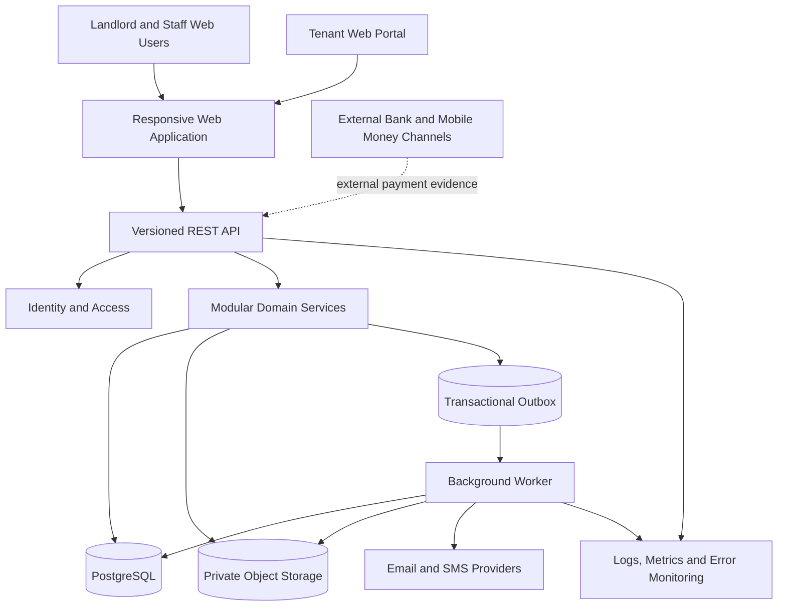
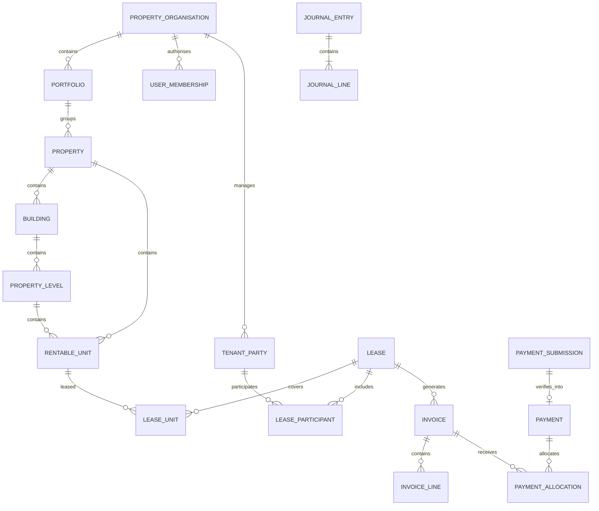
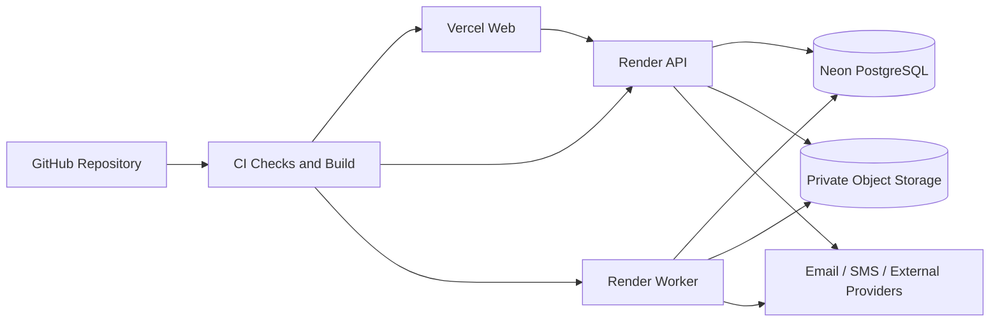

# AMAALPROP — System Architecture

**Document:** `architecture.md`  
**Version:** 1.0  
**Date:** 13 November 2026  
**Status:** Proposed technical architecture baseline  
**Product:** Multi-organisation property management SaaS  
**Initial market:** Uganda, with internationalisation foundations  
**Source baseline:** AMAALPROP PRD v1.0 and AMAALPROP ERD v1.0, plus architecture decisions discussed with the product owner.

---

## 1. Purpose

This document defines the recommended technical architecture for AMAALPROP. It translates the product requirements and logical data model into an implementation-oriented system design covering application structure, domains, deployment, data security, workflows, integrations, operations and delivery phases.

It is an architecture baseline, not a claim that the application has already been implemented or deployed. Technology choices marked **recommended** remain subject to confirmation before implementation.

### 1.1 Product definition

AMAALPROP is a property operations and financial management platform for independent landlords and property management organisations. It manages:

- Organisations, users, roles, permissions and scoped staff assignments.
- Portfolios, properties, buildings, levels and rentable units.
- Tenant parties, people, occupants, leases and lease participants.
- Rent and other charges, billing schedules, invoices and reminders.
- Landlord payment instructions, tenant payment submissions, staff verification, payment allocations and receipts.
- Double-entry accounting, deposits, expenses, refunds, reversals and reconciliation.
- Maintenance requests, work orders, inspections, move-out and clearance.
- Approval policies, notifications, documents, audit history and reporting.

AMAALPROP is not simply a tenant register or rent reminder tool. It is the controlled operating and financial record for a property organisation.

### 1.2 Architecture principles

1. **Web first, mobile later.** Deliver a responsive web application first. Design APIs and user journeys so native mobile applications can be added after customer validation without rebuilding the backend.
2. **Modular monolith first.** Keep one deployable backend with explicit domain boundaries. Do not introduce microservices before scale, team structure or independent deployment needs justify them.
3. **Organisation isolation by design.** Tenant separation must be enforced in the API, database, storage, background jobs, caches and reporting paths.
4. **Global identity, separate access.** A login identity is not the same thing as a tenant profile, employee record or organisation membership.
5. **Financial correctness over convenience.** Every posted journal balances; posted financial records are immutable; corrections use reversals and replacement entries.
6. **Explicit state transitions.** Leases, payment submissions, invoices, approvals, work orders and clearance cases use validated state machines.
7. **Auditable operations.** Important actions are attributable to an actor, organisation, timestamp and business record.
8. **Private by default.** Sensitive documents and personal information are never exposed through public storage or unrestricted URLs.
9. **API-first contracts.** The web client and future mobile clients consume the same versioned API.
10. **Incremental delivery.** Build and test the foundations before enabling financial posting or complex operational workflows.

---

## 2. High-level architecture



### 2.1 Logical layers

| Layer | Responsibility |
|---|---|
| Presentation | Responsive landlord/staff workspace and tenant portal |
| API edge | Authentication, request validation, rate limits, versioning and response contracts |
| Application layer | Use cases, orchestration, transaction boundaries and authorisation checks |
| Domain layer | Business rules for property, leases, billing, payments, accounting and operations |
| Persistence | PostgreSQL repositories, constraints, migrations and row-level security |
| File layer | Private object storage, metadata, access checks and short-lived download links |
| Asynchronous layer | Outbox processing, scheduled jobs, notifications, reminders and document/report tasks |
| Operations | Logging, metrics, tracing, alerts, backups and restore procedures |

The frontend must not connect directly to PostgreSQL. All business writes and sensitive reads pass through the authenticated backend.

---

## 3. Recommended technology stack

The following is a practical TypeScript-oriented stack for a web-first SaaS. These are recommendations, not requirements already mandated by the PRD.

| Concern | Recommended choice | Reason |
|---|---|---|
| Web application | Next.js + TypeScript | Responsive web UI, routing, server rendering where useful and mature ecosystem |
| UI | React with an accessible component system | Reusable forms, tables, dashboards and workflow screens |
| Backend API | NestJS + TypeScript | Modular structure, dependency injection, validation and testability |
| API style | REST with OpenAPI | Straightforward web/mobile integration and generated client support |
| Database | PostgreSQL | Transactions, constraints, relational integrity, JSON support and row-level security |
| Data access | SQL-first migrations; typed query/repository layer | Critical financial and tenant-scope rules remain visible and testable |
| Background jobs | PostgreSQL outbox + worker initially | Reliable event delivery without premature infrastructure |
| Object storage | Private S3-compatible object storage | Secure storage of leases, IDs, receipts and inspection evidence |
| Authentication | Managed identity provider or securely implemented session-based auth | Avoid custom password/security infrastructure unless there is a strong reason |
| Hosting | Web frontend on Vercel; API and worker on Render; PostgreSQL on Neon as a candidate topology | Separates user-facing web delivery, API execution, background work and database |
| Source control | GitHub | Pull requests, CI, migrations review and release traceability |
| Monitoring | Structured logs, error tracking, metrics and uptime checks | Detect failures across API, jobs, database and integrations |

### 3.1 Hosting decision gate

Vercel + Render + Neon is a workable candidate topology, not an automatic production approval. Before committing customer data, confirm:

- Data residency and cross-border processing obligations for Uganda and each later launch country.
- Provider regions, subprocessors, backups, logs and support-access locations.
- Contractual data-processing terms and the organisation's PDPO registration/compliance obligations.
- Whether the selected regions and provider configuration meet the product's privacy and recovery requirements.
- Production backup, restore, retention and incident-response procedures.

Obtain qualified local legal advice on cross-border processing and retention. Do not represent a hosting region as legally compliant without that review.

### 3.2 Runtime separation

Run the web frontend, API and background worker as separate runtime workloads:

- **Web frontend:** serves the responsive application and calls the API.
- **API:** handles authenticated, bounded-duration business requests.
- **Worker:** handles scheduled and asynchronous work such as recurring invoices, reminders, notifications, file processing and report generation.

Do not run long-running recurring billing or notification loops inside web requests.

---

## 4. Backend modular monolith and domain boundaries

The backend should be one deployable application organised into independent business modules. Each module owns its application services, domain rules, persistence interfaces and events. Modules communicate through explicit interfaces rather than reaching into one another's internal tables indiscriminately.

| Module | Owns |
|---|---|
| Platform | Organisation registration, organisation settings, SaaS plans and platform-level configuration |
| Identity and Access | Global user accounts, authentication integration, memberships, invitations, roles, permissions, reporting relationships and scope assignments |
| Property | Portfolios, properties, buildings, levels, unit types, rentable units, features and occupancy policies |
| Tenant | Tenant parties, tenant persons, contacts, identification records, tenant portal invitations and tenant access |
| Lease | Lease terms, lease units, participants, renewals, variations, termination and occupancy activation |
| Billing and Revenue | Charge types, rent policies, billing schedules, invoices, invoice lines, due dates and tenant financial status |
| Payments | Payment instructions, submissions, verification, confirmed payments, allocations, receipts, refunds and payment events |
| Accounting | Chart of accounts, accounting periods, journal entries, journal lines, reversals, deposits, expenses and reconciliation |
| Maintenance | Maintenance requests, contractors/suppliers, work orders, costs and work-order history |
| Inspections and Clearance | Move-out requests, inspection templates, inspections, evidence, clearance steps, decisions and deposit settlement |
| Approvals | Reusable approval policies, approval requests, decisions, delegation, escalation and immutable decision history |
| Communications | Notification templates, delivery attempts, communication history, email and SMS provider adapters |
| Documents | File metadata, classification, ownership, retention, access policy and private storage integration |
| Reporting | Operational and financial read models, statements, dashboards and exports |
| Audit and Compliance | Audit events, security events, data access history and retention workflows |

### 4.1 Domain ownership rules

- A module may expose application services and read models to other modules.
- A module must not bypass another module's business rules by writing directly to its tables.
- Cross-module workflows are coordinated by application services and explicit domain events.
- Database foreign keys and constraints still enforce relational integrity across modules.
- Avoid circular module dependencies.
- Keep financial posting logic inside the Accounting module, invoked by authorised Payments, Billing, Expenses or Deposit workflows.

### 4.2 Internal events

Use named, versioned events for meaningful business facts, for example:

- `OrganisationCreated`
- `EmployeeInvitationAccepted`
- `PropertyCreated`
- `LeaseActivated`
- `InvoiceIssued`
- `PaymentSubmissionReceived`
- `PaymentVerified`
- `PaymentAllocated`
- `JournalPosted`
- `MaintenanceRequestCreated`
- `WorkOrderCompleted`
- `InspectionSubmitted`
- `ClearanceApproved`
- `LeaseTerminated`

Events describe completed facts. Commands request an action and must be validated before the corresponding event is emitted.

---

## 5. Identity, organisation and access architecture

### 5.1 Separate identity from business records

Maintain distinct concepts:

- `user_accounts`: global login identity and authentication metadata.
- `property_organisations`: landlord/property management organisation.
- `organisation_memberships`: authorised relationship between a user account and an organisation.
- `tenant_parties`: legal or business parties renting property.
- `tenant_persons`: natural persons connected to tenant parties.
- `lease_participants`: tenant parties participating in a particular lease.
- `occupants`: people permitted to occupy a unit, whether or not they are financially liable.

A tenant profile must not be created as a second login identity simply because the same person is also an employee or portal user.

### 5.2 Confirmed email decision

The product owner has clarified that an email address is unique across the entire AMAALPROP system. The architecture therefore uses one global account per normalised email address, not a separate account for each organisation.

Required controls:

- Store a consistently normalised email value.
- Enforce a global unique constraint on `user_accounts.normalised_email`.
- Use the global account for authentication and recovery.
- Do not create duplicate accounts for the same email under different organisations.
- Do not confuse global account uniqueness with organisation authorisation. A valid login does not grant access to any organisation by itself.
- Require explicit, authorised organisation membership before organisation data is available.

**Membership cardinality decision to preserve:** the original PRD/ERD states that one email identity belongs to one property organisation and that cross-organisation work requires separate email identities. The later clarification confirms global uniqueness. Unless the product owner explicitly changes the original restriction, enforce one active organisation membership per account and provide a controlled transfer process. If the business later permits one account to work for multiple organisations, that is a deliberate policy and schema decision; do not quietly enable it.

### 5.3 Authorisation model

Use three independent dimensions:

1. **Role:** what actions a person may perform.
2. **Scope assignment:** which organisation, portfolio, property, building or unit the person may act on.
3. **Reporting relationship:** who supervises whom.

A supervisor relationship must not automatically grant access to every property handled by a direct report.

Every protected API operation checks:

- Authenticated user.
- Active organisation membership.
- Required permission.
- Resource organisation ownership.
- Resource scope assignment, where applicable.
- Current workflow state and transition permissions.

Use least privilege and deny by default. Sensitive data such as passport/NIN details, payment destination details and inspection evidence require additional permissions.

### 5.4 Invitation and transfer flows

Employee and tenant portal activation must use invitation, contact verification and authorised approval as defined in the PRD.

Organisation transfer must be an explicit workflow that revokes old access, preserves historical audit attribution and grants new access only after approval. Never rewrite old activity as though it happened under the new organisation.

---

## 6. Multi-tenancy and data isolation

AMAALPROP is a shared SaaS serving independent landlord organisations. Organisation isolation is a critical security boundary.

### 6.1 Defence in depth

Implement all of the following:

1. **API enforcement:** derive the active organisation from the authenticated session and authorised membership. Never trust an arbitrary `organisation_id` supplied by the browser.
2. **Database enforcement:** use PostgreSQL row-level security (RLS) on organisation-owned tables.
3. **Relational integrity:** use composite foreign keys or equivalent constraints so records cannot reference parent rows belonging to another organisation.
4. **Storage enforcement:** files are private and associated with organisation-owned records. Authorise every file access.
5. **Worker enforcement:** background jobs carry explicit organisation context and re-check ownership before reading or writing.
6. **Cache enforcement:** include organisation and user scope in cache keys. Never share tenant-specific data across organisations.
7. **Reporting enforcement:** all reports, exports and analytics queries apply the same organisation and scope filters.
8. **Testing:** test cross-organisation access attempts through API, database, storage, jobs and exports.

### 6.2 Database RLS strategy

- Enable RLS on all organisation-owned tables.
- Create explicit `USING` and `WITH CHECK` policies for reads and writes.
- Set organisation context transaction-locally for each request/job.
- Use a restricted runtime database role; do not run the application as a superuser or table owner that bypasses RLS.
- Ensure pooled connections cannot retain one request's organisation context for another request.
- Test both positive access and negative cross-tenant access.
- Use separate migration/administration credentials from runtime credentials.

If a transaction-pooling database proxy is used, validate its session-setting behaviour. Prefer transaction-local context and keep each protected operation inside a database transaction.

### 6.3 Organisation-owned data

Every security-critical organisation-owned record should carry `organisation_id` directly where practical. This supports RLS policies, indexes and composite foreign keys without relying on long parent joins.

---

## 7. Core data architecture

PostgreSQL is the system of record. The ERD is a logical model and must be converted into engine-specific migrations only after constraints and workflows are reviewed.

### 7.1 Main relationship model



The model must preserve these distinctions:

- A property may be standalone or contain buildings, levels and units.
- A unit may be directly under a property or associated with a building/level.
- A lease may cover multiple units.
- A lease may include multiple tenant parties.
- A tenant party may participate in multiple leases.
- Occupants are not automatically financially liable lease participants.
- Payment submissions are not confirmed payments.
- Payment allocations are not the same thing as payments.
- Financial standing and physical clearance are separate statuses.

### 7.2 Property hierarchy

Recommended hierarchy:

`Organisation → Portfolio (optional) → Property → Building (optional) → Level (optional) → Rentable Unit`

Support standalone rentable units directly under a property. Do not force dummy buildings or floors.

Resolve the ERD/PRD relationship detail for `property_levels`: the ERD allows a nullable `building_id`, while the PRD describes levels as belonging to buildings. The physical schema should adopt one consistent rule before migrations. Custom level labels such as Basement, PZ and PN must be preserved.

### 7.3 Occupancy and lease concurrency

- Keep maximum tenant-party count separate from maximum occupant-person count.
- Store the occupancy policy snapshot used when a lease is activated.
- Validate occupancy when drafting and again at activation.
- Use transaction locks or equivalent concurrency controls when activating a lease.
- Prevent overlapping active leases unless shared occupancy is explicitly permitted.
- Do not impose a one-tenant-one-unit restriction.

---

## 8. Financial architecture

Financial integrity is a launch-critical requirement. The application must not enable live financial posting until the ledger, reversal and reconciliation controls are implemented and tested.

### 8.1 Financial subdomains

Separate these responsibilities:

- **Billing / Accounts Receivable:** charges, rent schedules, invoices, adjustments, due dates and arrears.
- **Collections / Payments:** payment instructions, submissions, verification, confirmed payments, allocations, receipts and refunds.
- **Deposits:** security-deposit receipts, deductions, liabilities and settlements.
- **Expenses / Accounts Payable:** suppliers, expense claims, approvals, bills and payments.
- **General Ledger:** chart of accounts, periods, journals, journal lines and balances.
- **Bank and cash reconciliation:** imported or manually recorded bank transactions, matching, exceptions and reconciliation status.
- **Financial reporting:** tenant statements, property statements, trial balance, P&L, balance sheet and cash-flow reporting.

Keep AMAALPROP's own SaaS subscription billing separate from landlords' rental accounting. Platform subscription invoices are not property rent invoices.

### 8.2 Payment workflow

The required workflow is:

1. Landlord configures payment instructions, optionally scoped to portfolio, property, building, unit or lease.
2. Tenant pays externally through the configured bank/mobile-money/cash channel.
3. Tenant submits payment details and a reference/evidence.
4. Submission remains pending until an authorised staff member independently verifies receipt.
5. Verification creates one confirmed payment.
6. The payment is allocated to one or more invoices, including partial allocations.
7. Excess or unapplied amounts remain explicitly recorded as customer credit/liability according to the accounting policy.
8. Receipt and statement records are made available to authorised users.
9. Any correction or refund is recorded through controlled reversal/refund workflows.

A screenshot or reference supplied by a tenant is evidence of a claim, not proof that money has reached the landlord.

### 8.3 Double-entry posting

- Every posted journal entry must balance: total debits equal total credits.
- Each journal line has exactly one debit or credit side.
- Posted journal entries and lines are immutable.
- Corrections use reversal and replacement entries linked to the original.
- Deposits are liabilities until legally/accountingly earned or applied; do not record refundable deposits as rental income.
- Payment verification and ledger posting must be atomic or coordinated with idempotent posting controls.
- A duplicate event or API retry must not create duplicate payments, receipts, allocations or journals.
- Use accounting periods and prevent posting into closed periods without authorised reopening.
- Record currency, exchange rate and base-currency amounts where multi-currency operations are enabled.

### 8.4 Important ERD gaps to close before financial migrations

The current logical model provides a strong starting point, but detailed design must confirm or add:

- Dedicated refund records and refund state transitions.
- Supplier/vendor master data and supplier bills/AP workflow.
- Bank transaction import/entry and reconciliation records.
- Receipt numbering and receipt lifecycle.
- Currency and exchange-rate snapshots, including base-currency amounts.
- Accounting-period close/reopen controls.
- Idempotency keys and unique source references for financial posting.
- Explicit links from business events to their resulting journal entries.

Do not treat an expense text field containing a supplier name as a complete supplier/AP model.

### 8.5 Accounting policy decisions

Before production accounting is enabled, approve country-specific tax treatment, accounting basis, joint-tenant liability, foreign currency treatment, cash-payment controls, refund authority and retention requirements with qualified accounting/legal advisers.

---

## 9. Workflow and approval architecture

Use explicit state machines for:

- Organisation onboarding and verification.
- User invitations and account activation.
- Lease drafting, approval, activation, renewal, variation and termination.
- Billing schedule generation and invoice issue.
- Payment submission, verification, allocation, refund and reversal.
- Expense submission, approval and payment.
- Maintenance request and work-order lifecycle.
- Move-out request, inspection, financial settlement and final clearance.

Every transition must validate the actor's permission, organisation scope, current state, required fields and approval policy.

### 9.1 Reusable approval engine

Implement a common approval engine rather than building unrelated approval logic into each module. It should support:

- Policy scope and effective dates.
- Thresholds and action types.
- Required approver roles/permissions.
- Sequential or parallel approvals.
- Requester/approver separation where required.
- Delegation with effective dates and scope.
- Approve, reject, return-for-correction and cancel decisions.
- Expiry, reminders and escalation.
- Immutable decision history and actor attribution.

Use it for lease exceptions, payment exceptions, expenses, maintenance expenditure and final clearance. The clearance process must preserve its required caretaker → property manager → landlord/delegate sequence.

---

## 10. Background jobs and reliable event processing

Use a transactional outbox pattern:

1. Commit the business change and an outbox event in the same database transaction.
2. A worker reads unprocessed outbox rows.
3. The worker performs the external or asynchronous action.
4. It records success or retryable failure.
5. Failed jobs retry with bounded backoff and eventually enter a dead-letter/review state.

### 10.1 Initial jobs

- Recurring invoice generation.
- Rent due reminders and arrears status refresh.
- Payment submission notifications and verification reminders.
- Receipt and statement delivery.
- Lease expiry and renewal reminders.
- Maintenance and work-order reminders.
- Inspection and clearance scheduling.
- File scanning/processing where available.
- Scheduled reports and exports.
- Notification retries and delivery-status updates.

### 10.2 Idempotency

Every job and event consumer must tolerate duplicate delivery. Use stable event IDs, unique business keys and idempotency records. A retry must never issue a second invoice, receipt or journal for the same source event.

Start with a PostgreSQL-backed outbox and worker. Add a dedicated queue or Redis-backed job system only when workload and operational evidence justify it.

---

## 11. API and integration architecture

### 11.1 API standards

- Version the API, for example `/api/v1`.
- Publish an OpenAPI specification and keep it in source control.
- Use DTO/schema validation at the API boundary.
- Return consistent error structures and validation details.
- Apply pagination, filtering and sorting to collection endpoints.
- Use idempotency keys for financial and other retry-sensitive commands.
- Use optimistic concurrency/version fields for records that can be edited by multiple staff.
- Enforce rate limits on authentication, invitations, uploads and sensitive operations.
- Avoid exposing internal database IDs or fields that the client does not need.
- Record correlation/request IDs for support and tracing.

### 11.2 API domain groups

Example route groups:

```text
/api/v1/auth/*
/api/v1/organisations/*
/api/v1/memberships/*
/api/v1/roles/*
/api/v1/properties/*
/api/v1/units/*
/api/v1/tenants/*
/api/v1/leases/*
/api/v1/billing/*
/api/v1/payment-instructions/*
/api/v1/payment-submissions/*
/api/v1/payments/*
/api/v1/accounting/*
/api/v1/expenses/*
/api/v1/maintenance/*
/api/v1/inspections/*
/api/v1/clearance/*
/api/v1/approvals/*
/api/v1/documents/*
/api/v1/reports/*
```

These are illustrative resource groups, not a final endpoint contract.

### 11.3 External integrations

Initial release does not require every landlord to connect a bank or mobile-money API. The platform supports landlord-configured payment instructions and manual submission/verification.

Design provider adapters for future integrations:

- Email and SMS.
- Bank statement import and bank APIs.
- Mobile-money APIs where commercially and legally available.
- Payment gateway for AMAALPROP subscription billing.
- Accounting/export integrations.
- Identity/document verification providers, if approved.

Treat every webhook as untrusted input: verify signatures, validate timestamps, deduplicate events and store provider references.

---

## 12. File and document architecture

Store file bytes in private object storage and metadata in PostgreSQL.

Metadata should include:

- Organisation and owning business record.
- Document category and classification.
- Original filename, content type, size and checksum.
- Uploaded-by account and upload timestamp.
- Retention category and lifecycle status.
- Malware-scan or processing status where supported.
- Access policy and audit history.

Security requirements:

- No public buckets for tenant, lease, identity or financial documents.
- Use short-lived signed URLs only after server-side authorisation.
- Validate file type and size; do not trust browser-provided MIME types.
- Scan uploads where available.
- Encrypt storage and sensitive database fields using managed keys.
- Log access to sensitive documents.
- Apply retention and legal-hold rules before deletion.
- Ensure exports and generated reports use the same access controls.

---

## 13. Frontend architecture and user experience

### 13.1 Web-first delivery

Build one responsive web application with role-appropriate navigation and dashboards. Do not create separate frontends for every staff role in the first release.

Primary workspaces:

- Organisation owner / landlord.
- Director or general manager.
- Regional, portfolio and property manager.
- Site manager and caretaker.
- Accountant / finance officer.
- Leasing officer.
- Tenant portal.
- Occupant/representative access where approved.

### 13.2 Frontend structure

Organise the frontend by product domain:

```text
src/
  app/
  components/
  features/
    identity/
    organisation/
    property/
    tenants/
    leases/
    billing/
    payments/
    accounting/
    maintenance/
    inspections/
    clearance/
    approvals/
    reports/
    documents/
  lib/
    api-client/
    auth/
    permissions/
    validation/
    formatting/
  styles/
```

The client may hide actions the user cannot perform for usability, but the backend remains the authority for every permission decision.

### 13.3 Mobile readiness

Responsive design must support phone-sized screens for daily property operations. Native mobile applications can be added later using the same API and domain contracts. Prioritise mobile web usability for inspections, evidence capture and payment submission without committing to native apps before customer demand is proven.

---

## 14. Security, privacy and audit

### 14.1 Authentication

- Use secure, modern authentication and session handling.
- Require email verification and controlled invitations.
- Support MFA for organisation owners and privileged staff.
- Apply secure password reset and account recovery.
- Protect login and invitation endpoints with rate limiting and abuse detection.
- Revoke sessions when accounts are disabled, transferred or compromised.

### 14.2 Application security

- Enforce HTTPS.
- Apply CSRF protections where cookie-based sessions are used.
- Use secure, HttpOnly and appropriate SameSite cookies.
- Validate and encode input/output to reduce injection and XSS risks.
- Use parameterised SQL.
- Apply security headers and restrictive CORS.
- Keep secrets in managed secret storage, never in source code or client bundles.
- Separate development, staging and production credentials.
- Review dependencies and patch vulnerabilities.
- Perform security testing against an established application-security verification standard.

### 14.3 Audit events

Audit at minimum:

- Login/security events and account activation.
- Organisation owner and membership changes.
- Role, permission and scope changes.
- Lease creation, amendment, activation and termination.
- Rent/charge changes and invoice issuance.
- Payment verification, allocation, refund and reversal.
- Journal posting, reversal and period close/reopen.
- Expense and approval decisions.
- Inspection submissions and verification.
- Final clearance and deposit settlement.
- Sensitive document access and export.

Audit records should be append-only to normal application roles and include actor, organisation, action, target record, timestamp, request/correlation ID and relevant before/after values where appropriate. Avoid copying unnecessary sensitive data into audit payloads.

### 14.4 Privacy and retention

Define retention and deletion rules for identity documents, leases, financial records, inspection evidence, communications and audit records. Support data export and controlled deletion where lawful. Complete a privacy/data-protection review for the initial market and each expansion country.

---

## 15. Reporting and analytics

The transactional PostgreSQL database remains the source of truth. Begin with indexed reporting queries and carefully designed read models. Do not introduce a separate data warehouse until volume or reporting needs justify it.

Reports must respect organisation membership, role permissions and property scope. Export generation should run asynchronously for large reports, store the result privately and issue a short-lived authorised download link.

Core reports include:

- Property and unit occupancy.
- Vacant, occupied, reserved and unavailable units.
- Lease expiry and renewal pipeline.
- Rent billed, collected, outstanding and arrears.
- Tenant statements and property statements.
- Payment verification queue and unapplied receipts.
- Deposit liabilities and settlements.
- Expenses and maintenance costs.
- Trial balance, P&L, balance sheet and cash flow.
- Staff workload and operational performance.

Financial reports must derive from posted accounting data, not from unverified payment submissions or mutable dashboard counters.

---

## 16. Deployment and environments

### 16.1 Candidate topology



### 16.2 Environments

Maintain isolated:

- **Development:** local development and disposable test data.
- **Staging:** production-like configuration, synthetic or properly anonymised data, full acceptance tests.
- **Production:** customer data, restricted access, monitored releases and verified backups.

Do not use production customer data in development. Secrets, database roles, storage buckets and provider credentials must be environment-specific.

### 16.3 CI/CD gates

Every pull request should run:

1. Formatting and linting.
2. Type checking.
3. Unit tests.
4. Domain and API integration tests.
5. Database migration validation.
6. RLS and tenant-isolation tests.
7. Build checks.
8. Dependency/security checks.

Before production release:

- Review migration SQL and rollback/forward-recovery plan.
- Take and verify a database backup.
- Confirm file-storage backup/retention coverage.
- Run staging end-to-end acceptance tests.
- Obtain release approval.
- Deploy in a controlled sequence.
- Run smoke tests and monitor logs/metrics.
- Keep a tested rollback or recovery procedure.

Database migrations must be versioned, reviewed and applied through the approved release process. Avoid manual production schema edits.

---

## 17. Reliability, performance and recovery

### 17.1 Performance approach

- Add indexes for organisation filters, foreign keys and frequent operational queries.
- Use pagination for lists and server-side filtering for large datasets.
- Avoid N+1 query patterns.
- Use database transactions for multi-record financial and lease workflows.
- Use asynchronous jobs for long-running tasks and large exports.
- Cache only where correctness and tenant isolation can be preserved.
- Measure query latency and database connection utilisation before scaling infrastructure.

### 17.2 Reliability

- Health and readiness endpoints for API and worker.
- Structured application logs with correlation IDs.
- Error tracking and alerting.
- Worker retry limits and dead-letter visibility.
- Database connection and pool monitoring.
- Provider delivery status and webhook failure monitoring.
- Uptime checks for public application and API endpoints.

### 17.3 Recovery

Define and approve Recovery Time Objective (RTO) and Recovery Point Objective (RPO) before production. Test restoration of both database and private object storage. A backup is not considered reliable until restoration has been demonstrated.

---

## 18. Testing strategy and release acceptance

Testing must prove business correctness and tenant isolation, not just successful page rendering.

### 18.1 Test layers

- **Unit:** calculations, state transitions, permission policies and accounting rules.
- **Integration:** database constraints, transactions, RLS, repositories and provider adapters.
- **API contract:** OpenAPI schemas, validation and error handling.
- **End-to-end:** full landlord, staff and tenant workflows.
- **Security:** cross-tenant access, privilege escalation, document access and session controls.
- **Concurrency:** simultaneous lease activation, payment verification and invoice generation.
- **Recovery:** backup restore, outbox replay and worker retry behaviour.

### 18.2 Critical end-to-end acceptance flow

1. Register a landlord organisation and its designated owner.
2. Invite staff and assign roles, permissions, reporting relationships and property scopes.
3. Create a portfolio, property, optional building/levels and rentable units.
4. Register tenant parties and people; invite and approve portal access.
5. Create a lease with one or more units and one or more tenant parties.
6. Activate the lease after occupancy and approval checks.
7. Generate and issue rent invoices from the billing schedule.
8. Configure payment instructions and submit a tenant payment reference.
9. Verify actual receipt as an authorised staff member.
10. Create one confirmed payment, allocate it and issue a receipt.
11. Post balanced journal entries and confirm tenant/property statements.
12. Submit a maintenance request, approve expenditure where required and complete the work order.
13. Start move-out, complete caretaker inspection, manager verification, financial settlement and final landlord/delegate approval.
14. Settle deposits through controlled accounting entries and preserve the audit trail.

### 18.3 Mandatory negative tests

- User from Organisation A cannot read or modify Organisation B data.
- Tenant cannot access another tenant's lease, invoice, payment or documents.
- Staff outside a property scope cannot act on that property.
- Unverified payment submission cannot create a posted receipt or journal.
- Duplicate payment verification cannot create duplicate accounting entries.
- Unbalanced journals cannot be posted.
- Posted journals cannot be edited or deleted.
- Occupancy limits cannot be exceeded through concurrent lease activation.
- A caretaker cannot perform final clearance without explicit authority.
- A changed URL or API identifier cannot bypass permissions or scope checks.

---

## 19. Implementation roadmap

The sequence below aligns the PRD release plan with the ERD's implementation order and adds technical dependencies.

### Phase 0 — Architecture and platform foundation

- Confirm architecture decisions and open product questions.
- Set up repository, branching, CI and environment separation.
- Implement organisation registration and owner identity.
- Implement global account uniqueness, memberships, invitations and access control.
- Implement audit foundation and tenant isolation/RLS.
- Set up migrations, private file storage, monitoring and backup/restore.
- Publish initial OpenAPI contract.

**Exit gate:** a user can securely register an organisation, invite authorised staff and prove that organisation data is isolated.

### Phase 1 — Property foundation

- Portfolios, properties, buildings, levels, unit types and rentable units.
- Standalone unit support and custom labels.
- Occupancy policies and staff scope assignments.
- Property dashboards and basic exports.

**Exit gate:** representative property structures can be modelled without artificial hierarchy records.

### Phase 2 — Tenants and leases

- Tenant parties, tenant persons, contacts and documents.
- Tenant invitations and portal activation.
- Leases, lease units, lease participants and occupancy snapshots.
- Lease approval, activation, renewal and variation.
- Lease documents and event history.

**Exit gate:** multi-tenant and multi-unit lease scenarios pass acceptance and concurrency tests.

### Phase 3 — Billing, payments and accounting

- Charge types, billing schedules and invoice generation.
- Payment instructions and tenant payment submissions.
- Staff verification, payment allocations and receipts.
- Chart of accounts, accounting periods, journals and journal lines.
- Deposits, reversals, refunds and core statements.
- Basic reconciliation and financial status history.

**Exit gate:** financial posting is enabled only after balanced immutable journals, idempotency, reversals and reconciliation tests pass.

### Phase 4 — Operations and clearance

- Maintenance requests, work orders and suppliers.
- Expense workflow and approvals.
- Inspection templates, reports and evidence.
- Move-out and clearance.
- Deposit settlement and handover.

**Exit gate:** the complete maintenance and tenant exit processes are auditable and permission-controlled.

### Phase 5 — Communications and analytics

- Email/SMS templates and delivery history.
- Reminders and scheduled notifications.
- Operational dashboards and financial reports.
- Asynchronous exports and advanced reporting.

### Phase 6 — Expansion

- SaaS subscription plans and entitlements.
- Advanced AP and bank reconciliation.
- Country-specific tax and accounting configuration.
- External bank/mobile-money integrations.
- Multi-currency support and advanced analytics.
- Native mobile applications when customer demand justifies them.

---

## 20. Decisions locked and decisions still open

### 20.1 Locked architecture/product decisions

- AMAALPROP is a multi-organisation property management and financial operations SaaS.
- Web application first; mobile applications later.
- Modular monolith initially; no premature microservices.
- PostgreSQL is the relational system of record.
- Organisation data must be strictly isolated.
- One global AMAALPROP account per normalised email address.
- Authentication alone does not grant organisation access.
- Property hierarchy supports optional buildings and levels and standalone units.
- Tenant parties, people, occupants, login accounts and lease participants are distinct.
- Payment submissions require independent staff verification before becoming confirmed payments.
- Full double-entry accounting is required.
- Posted journals are immutable and corrected by reversal.
- Refundable security deposits are treated as liabilities until properly applied or settled.
- Tenant financial standing and physical clearance are separate statuses.
- Background work uses reliable asynchronous processing and idempotency.

### 20.2 Decisions requiring explicit approval before production schema finalisation

1. **Organisation membership cardinality:** confirm whether one global account may ever be invited to multiple landlord organisations. The existing PRD/ERD rule says one organisation per email identity; the later clarification confirms global email uniqueness. This document preserves the stricter one-organisation-per-account interpretation until explicitly changed.
2. **Organisation verification:** documents and review required before an organisation can operate.
3. **Organisation transfer:** exact workflow for staff changing employers or landlords.
4. **Joint tenant liability:** joint liability by default or configurable allocation.
5. **Occupant access:** which portal information occupants who are not legal tenants may see.
6. **Cash payments:** whether supported at launch and required receipt controls.
7. **Accounting basis and tax:** country-specific tax, withholding and cash/accrual reporting rules.
8. **Multi-currency:** lease currency, base currency, exchange-rate source and realised/unrealised differences.
9. **Approval separation:** actions where requester and approver must be different people.
10. **Tenant account changes:** email change, tenant transfer and account recovery rules.
11. **Retention:** statutory and contractual retention periods for financial records, leases, identity documents and evidence.
12. **Hosting and data residency:** approved provider, regions, subprocessors and legal basis for cross-border processing.
13. **SaaS billing:** trial, plans, limits, entitlements, grace periods and payment collection timing.

---

## 21. Architecture decision records

| ID | Decision | Status |
|---|---|---|
| ADR-001 | Use a modular monolith initially | Accepted |
| ADR-002 | Deliver responsive web first; keep API reusable for future mobile | Accepted |
| ADR-003 | PostgreSQL is the system of record | Recommended; confirm provider |
| ADR-004 | Enforce organisation isolation at API, database, storage and worker layers | Required |
| ADR-005 | One global account per normalised email | Accepted |
| ADR-006 | One organisation membership per account | Preserved from PRD/ERD; reconfirm explicitly |
| ADR-007 | Use immutable double-entry journals and reversal workflows | Required |
| ADR-008 | Use transactional outbox and idempotent background workers | Recommended |
| ADR-009 | Use private object storage for sensitive files | Required |
| ADR-010 | Vercel + Render + Neon candidate deployment | Proposed; subject to region, legal and operational review |

---

## 22. Definition of architecture readiness

Architecture is ready to move into detailed implementation when:

- Domain boundaries and ownership are approved.
- The global identity and organisation membership rule is unambiguous.
- The ERD has been reconciled with all confirmed business rules.
- Physical database constraints, indexes and RLS policies are specified.
- Financial posting, reversal, refund and reconciliation workflows are fully modelled.
- API contracts and state-transition specifications are documented.
- Private file storage and retention controls are designed.
- Hosting region, data protection and recovery decisions are approved.
- CI/CD, staging, monitoring, backup and restore processes are in place.
- End-to-end and tenant-isolation acceptance tests are defined.

**This architecture is the implementation baseline for AMAALPROP. It does not replace the PRD or ERD. The PRD remains the product requirements authority; the ERD remains the logical data model; this document defines how those requirements should be realised in the application and infrastructure.**
