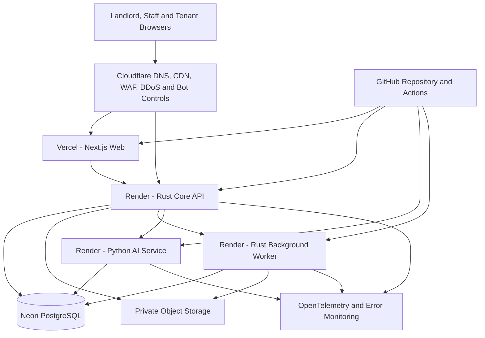

# AMAALPROP Technology Stack and Repository Structure

**Version:** 1.0  
**Date:** 13 November 2026  
**Status:** Proposed engineering baseline  
**Delivery strategy:** Web first, mobile later

## 1. Purpose and fixed infrastructure

This document defines the recommended technology stack and repository layout for AMAALPROP, using the infrastructure choices specified by the product owner:

- **Frontend:** Vercel
- **Backend:** Render
- **Database:** Neon PostgreSQL
- **Version control and CI/CD source:** GitHub
- **Edge security, DNS and CDN:** Cloudflare
- **Containers:** Docker and Docker Compose
- **Core backend:** Rust (proposed)
- **AI and machine learning:** Python (proposed)
- **Specialised native compute:** C++ only when profiling justifies it

AMAALPROP is a long-lived, multi-organisation property management and financial operations platform. It needs strong relational integrity, tenant isolation, reliable financial workflows, document processing, background jobs and an extensible AI layer.

The recommended architecture is a **polyglot modular system**, not a collection of premature microservices: TypeScript for the web application, Rust for authoritative business operations, Python for AI, and PostgreSQL for durable business data.

### Architecture principles

1. Web-first and responsive; future mobile applications reuse the same API.
2. One authoritative backend for core business rules and financial posting.
3. Organisation isolation at API, database, file, worker and AI retrieval layers.
4. PostgreSQL transactions and constraints protect financial correctness.
5. Posted accounting entries are immutable; corrections use reversals.
6. AI assists and recommends but cannot independently approve payments or post journals.
7. Docker makes development, CI, staging and production builds reproducible.
8. GitHub is the source of truth for code, migrations, infrastructure and release history.
9. Cloudflare complements, but does not replace, application authentication and database security.
10. Keep deployable services few and domain boundaries clear.

---

## 2. High-level system topology



| Service | Hosting | Responsibility |
|---|---|---|
| `amaal-web` | Vercel | Next.js frontend and tenant portal |
| `amaal-core-api` | Render | Rust API and authoritative business rules |
| `amaal-ai` | Render | Python AI and document intelligence |
| `amaal-worker` | Render | Scheduled and asynchronous jobs |
| PostgreSQL | Neon | Transactional system of record |
| Object storage | Private S3-compatible service | Documents, receipts, photos and exports |
| Edge | Cloudflare | DNS, TLS, CDN, WAF, DDoS and bot controls |
| Source/CI | GitHub | Code review, Actions and release history |

The API and worker can share the same Rust workspace and domain code while running as separate Render services. This enables independent scaling without duplicating business rules.

---

## 3. Recommended technology stack

### 3.1 Frontend — Vercel

| Area | Technology | Purpose |
|---|---|---|
| Framework | Next.js + React | Web application and tenant portal |
| Language | TypeScript | Typed frontend development |
| Styling | Tailwind CSS | Responsive design system |
| Components | shadcn/ui + Radix UI | Accessible reusable components |
| Forms | React Hook Form | Complex data-entry forms |
| Validation | Zod | Frontend schema validation |
| Server state | TanStack Query | API fetching, caching and invalidation |
| Tables | TanStack Table | Operational and financial tables |
| Charts | Apache ECharts or Recharts | Dashboards and reporting |
| Unit/component tests | Vitest + Testing Library | Frontend tests |
| Browser E2E | Playwright | Full user journey tests |

Frontend rules:

- The Rust API is authoritative for permissions and business state.
- Client-side permission checks improve usability but are not security enforcement.
- Use server rendering selectively; authenticated data must be fetched through authorised API paths.
- Never expose database credentials, AI provider keys or privileged secrets in browser bundles.
- Do not publicly cache authenticated tenant-specific responses.
- Design responsive phone workflows even though native mobile is deferred.

### 3.2 Core backend — Rust on Render

**Recommended framework:** Axum  
**Async runtime:** Tokio  
**Database access:** SQLx  
**API contract:** OpenAPI, maintained alongside the API.

| Technology | Responsibility |
|---|---|
| Rust stable toolchain | Core backend language |
| Axum | HTTP routing and request handling |
| Tokio | Async runtime |
| Tower | Middleware composition |
| SQLx | Async PostgreSQL access and connection pools |
| Serde | Serialization |
| `rust_decimal` | Exact decimal arithmetic |
| `time` or `chrono` | Date/time handling; select one consistently |
| Utoipa | OpenAPI documentation |
| tracing | Structured logs and spans |
| validator or garde | Input validation where appropriate |
| Argon2 implementation or managed identity | Password hashing only if auth is self-managed |

Core Rust domain modules:

- Platform and organisations
- Identity and access
- Property and units
- Tenants and occupants
- Leases
- Billing and revenue
- Payments and allocations
- Accounting and ledger
- Maintenance and work orders
- Inspections and clearance
- Approvals
- Documents and communications
- Reporting
- Audit and compliance

Keep these as modules in one Rust application initially. Each module owns its rules and exposes explicit application services. Other modules must not bypass those rules by writing directly to its tables.

**Financial rule:** use PostgreSQL `NUMERIC` and decimal arithmetic in Rust. Never use binary floating-point for money. Define currency precision and rounding explicitly.

### 3.3 AI and document intelligence — Python on Render

**Recommended service:** FastAPI, deployed separately from the core API.

| Technology | Responsibility |
|---|---|
| Python stable release | AI service language |
| FastAPI | Internal AI HTTP service |
| Pydantic | Typed request and response schemas |
| PyTorch | Model training and inference |
| Hugging Face Transformers | Language and document models |
| LangGraph | Stateful multi-step workflows and human review |
| LlamaIndex | Document ingestion, retrieval and RAG |
| pgvector | Initial vector search in Neon PostgreSQL |
| sentence-transformers | Embedding generation where appropriate |
| ONNX Runtime | Optional optimised model inference |
| pytest | AI service tests |
| MLflow or equivalent | Optional experiment/model tracking when needed |

Build AI capabilities incrementally:

1. Lease and document extraction with confidence scores and human confirmation.
2. Semantic search across authorised leases, inspections and maintenance history.
3. Natural-language reporting over approved, permission-filtered data.
4. Maintenance categorisation and recurring-fault analysis.
5. Drafting tenant communications and summarising conversations.
6. Financial anomaly detection and collection trend analysis.

AI safety boundaries:

- AI is not the system of record.
- Extracted information remains a candidate until validated.
- Every request carries verified user and organisation context from the core API.
- Retrieval enforces organisation scope and permissions before content reaches a model.
- Never execute unrestricted model-generated SQL against production.
- Use allowlisted, read-only reporting tools for natural-language questions.
- Payment verification, journal posting, refunds, approvals and final clearance remain controlled workflows.
- Record model/provider, model version, prompt version, latency and cost where appropriate, without logging secrets or unnecessary personal data.

Start with managed model APIs where privacy, cost and quality are acceptable. Self-host models only when data protection, workload, latency or economics justify the operational burden. Do not assume a GPU is required for the first release.

### 3.4 C++ — optional specialised component

C++ is not required for the initial application backend. Introduce it only when profiling or product requirements identify a workload where native performance or a mature C++ library provides a material benefit.

Potential future uses include high-throughput image/video processing, document preprocessing, specialised analytics and native inference integrations such as ONNX Runtime.

If introduced, isolate the C++ component behind a narrow internal API or job interface. It must not become a second source of truth for leases, payments or accounting.

### 3.5 Database — Neon PostgreSQL

Neon PostgreSQL is the primary and authoritative database.

Database standards:

- Store migrations in GitHub.
- Use SQLx migrations or one standardised migration runner.
- Use `NUMERIC` for money and explicit currency codes.
- Use `timestamptz` for event timestamps and define business-local date rules.
- Enforce foreign keys, unique constraints, check constraints and appropriate indexes.
- Put `organisation_id` on organisation-owned records where practical.
- Use composite foreign keys to prevent cross-organisation relationships.
- Enable row-level security (RLS) on organisation-owned tables.
- Use a restricted runtime database role, not a superuser or table owner.
- Separate runtime, migration and administrative credentials.
- Validate transaction-local organisation context with the selected Neon pooling mode.
- Test migrations against isolated staging databases/branches before production.
- Establish backup retention and demonstrate restoration.

#### Multi-tenant RLS requirements

- Derive organisation access from authenticated, authorised membership.
- Set organisation context transaction-locally for every protected transaction.
- Policies must cover reads and writes (`USING` and `WITH CHECK` as appropriate).
- Missing organisation context must deny access.
- Worker jobs establish and verify their own organisation context.
- Test cross-organisation reads, writes, joins, exports and document access.
- Remember that privileged database roles can bypass ordinary RLS protections.

#### Region and connectivity

Choose the Neon region deliberately and measure its network distance from the selected Render region. Keep API, worker and database geographically close where available and legally appropriate. Measure real round-trip latency before production approval.

A nearby region does not by itself resolve Uganda's data-protection obligations. Cross-border processing, subprocessors, backups and support access require a separate legal/privacy review.

### 3.6 Background processing — Render worker

Run a separate Render worker container.

Recommended initial design:

- Transactional outbox table in PostgreSQL.
- Rust worker sharing domain crates with the core API.
- Evaluate Apalis for job execution and scheduling.
- Stable event IDs and idempotency keys.
- Bounded retries with exponential backoff.
- Failed/dead-letter jobs visible for operator review.

Initial jobs:

- Recurring invoice generation.
- Rent reminders and arrears refresh.
- Payment verification notifications.
- Receipt and statement delivery.
- Lease expiry and renewal reminders.
- Maintenance and work-order reminders.
- Inspection and clearance scheduling.
- Document processing and AI extraction orchestration.
- Scheduled report generation.
- Email/SMS delivery retries.

Write the business change and outbox event in the same database transaction. A queue does not replace transactional correctness.

### 3.7 Object and document storage

Use private S3-compatible object storage for lease agreements, identity documents, payment evidence, receipts, inspection photos, maintenance evidence and generated exports.

Store file metadata and ownership in PostgreSQL. Files are private by default. Generate short-lived signed links only after server-side authorisation. Validate size and content, scan for malware where available, encrypt stored files and audit sensitive access.

### 3.8 API and service communication

- Public application API: versioned REST, for example `/api/v1`.
- Contract: OpenAPI committed to GitHub.
- Frontend types/client: generated from OpenAPI where practical.
- Core API to AI: private internal HTTPS call with service authentication.
- Worker to core domains: shared Rust crates, not duplicated business logic.
- External webhooks: signature verification, timestamp validation, replay protection and deduplication.

Avoid adding GraphQL, Kafka, a service mesh or a separate event platform at launch unless a concrete requirement justifies it.

---

## 4. Cloudflare — advanced edge security and CDN

Cloudflare is the edge traffic and security layer for public web and API hostnames. It complements Vercel, Render and Neon; it does not replace application security.

### 4.1 Suggested hostname layout

| Hostname | Origin | Purpose |
|---|---|---|
| `www.amaalprop.com` | Vercel | Public website |
| `app.amaalprop.com` | Vercel | Authenticated web application |
| `api.amaalprop.com` | Render | API entry point through Cloudflare |
| `staging.amaalprop.com` | Vercel | Restricted staging application |
| `staging-api.amaalprop.com` | Render | Restricted staging API |

These are example hostnames; replace them with the registered AMAALPROP domain.

### 4.2 Cloudflare controls

Enable and configure, according to the selected Cloudflare plan:

- Authoritative DNS and DNSSEC.
- TLS with strict origin validation where supported.
- DDoS protection.
- Web Application Firewall managed rules.
- Custom WAF rules for sensitive endpoints.
- Rate limits for login, password reset, invitations, uploads and public API routes.
- Bot controls appropriate to the application.
- HTTPS redirects and security headers.
- Access policies for staging and internal tools.
- Security event logging and alerting.
- Origin protection so direct-origin access cannot casually bypass edge controls.

Validate the exact Vercel and Render custom-domain and certificate requirements before proxying hostnames. Keep provider-required DNS and certificate-validation records correct.

### 4.3 CDN caching policy

Cache only public, safe assets:

- Versioned JavaScript and CSS.
- Public images and marketing assets.
- Explicitly public immutable files.

Do not publicly cache:

- Authenticated API responses.
- Tenant or landlord dashboards.
- Invoices, receipts or statements.
- Identity documents and lease files.
- Organisation-specific reports.
- Any response containing private personal or financial data.

Use explicit cache-control headers and Cloudflare cache rules. Authenticated responses should normally be `private` or `no-store`, according to sensitivity. A cache key is not a tenant-isolation control.

Vercel already provides delivery infrastructure for frontend assets. Cloudflare should add DNS, security and carefully selected edge capabilities without conflicting cache behaviour. Test cookies, redirects, streaming, cache headers and API requests before enabling broad caching.

### 4.4 Origin protection

A proxied DNS record alone does not guarantee that an origin cannot be reached directly.

- Use custom domains and origin settings supported by Vercel and Render.
- Restrict staging and internal endpoints.
- Consider a Cloudflare Worker or another supported origin-authentication pattern if direct Render-origin access must be prevented.
- If using a shared secret origin header, keep it in Cloudflare secrets and Render secrets, rotate it, and reject requests missing it. Never expose it to browser code.
- Do not assume Render supports arbitrary inbound network allowlisting or Cloudflare Tunnel attachment; verify provider capabilities before choosing an origin-lockdown design.

The Rust API must still enforce authentication, authorisation, input validation, sensitive-operation rate limits and tenant isolation.

---

## 5. Docker and local development

Docker is required from the beginning.

### Container strategy

Create separate multi-stage Docker builds for:

- Rust core API.
- Rust worker.
- Python AI service.
- Next.js web app only if a local container or alternative deployment target is needed.

Vercel can build and deploy the frontend from GitHub. A frontend Dockerfile is optional; it should not create a competing production deployment path unless required.

Production containers should:

- Use pinned base image versions or digests where practical.
- Build in a separate builder stage.
- Run as a non-root user.
- Include only runtime dependencies.
- Exclude compilers, caches and development tools.
- Receive secrets at runtime, never baked into image layers.
- Expose health/readiness checks.
- Log to stdout/stderr.
- Be scanned for vulnerable packages and image layers.

### Local Docker Compose

The developer environment should include:

- Next.js web app.
- Rust API.
- Python AI service.
- Rust worker.
- Local PostgreSQL for isolated development and integration tests.
- S3-compatible local object storage.
- Local email testing service.
- Optional local observability collector.

Neon remains the managed staging/production database. Do not use production data locally. Validate migrations against the actual Neon PostgreSQL version and configuration.

---

## 6. GitHub repository and CI/CD

GitHub is the source of truth.

### Branching and review

- `main`: production-ready code.
- Short-lived feature branches.
- Pull requests required for merging.
- Required CI checks and review for production changes.
- Database migrations reviewed as code.
- Release tags identify deployable versions.

Keep secrets out of GitHub. Use provider secret stores or GitHub encrypted secrets; use OIDC deployment where supported.

### GitHub Actions pipeline

Pull request checks:

1. Rust formatting (`cargo fmt --check`).
2. Rust linting (`cargo clippy`).
3. Rust unit and integration tests.
4. Python lint/type checks and pytest.
5. TypeScript lint, type checks and frontend tests.
6. OpenAPI contract validation.
7. SQL migration validation.
8. RLS and cross-tenant security tests.
9. Docker image builds.
10. Dependency and container vulnerability scanning.

Release flow:

- Merge to the release branch triggers provider deployment from GitHub.
- Vercel builds the web frontend.
- Render deploys API, AI service and worker.
- Migrations run as a controlled release step, not automatically on every container startup.
- Staging smoke and end-to-end tests pass before production promotion.
- Production release requires approval, verified backup and migration recovery plan.

Keep staging and production credentials, Neon environments, object storage buckets and Cloudflare rules separate.

---

## 7. Proposed repository structure

Use a monorepo initially. It keeps API contracts, migrations, frontend integration and architecture decisions together while allowing each application to build and deploy independently.

```text
amaalprop/
├── .github/
│   ├── workflows/
│   │   ├── ci.yml
│   │   ├── security.yml
│   │   ├── deploy-web.yml
│   │   ├── deploy-render.yml
│   │   └── release.yml
│   ├── CODEOWNERS
│   └── pull_request_template.md
│
├── apps/
│   ├── web/                         # Next.js frontend (Vercel)
│   │   ├── public/
│   │   ├── src/
│   │   │   ├── app/
│   │   │   ├── components/
│   │   │   ├── features/
│   │   │   │   ├── identity/
│   │   │   │   ├── organisation/
│   │   │   │   ├── property/
│   │   │   │   ├── tenants/
│   │   │   │   ├── leases/
│   │   │   │   ├── billing/
│   │   │   │   ├── payments/
│   │   │   │   ├── accounting/
│   │   │   │   ├── maintenance/
│   │   │   │   ├── inspections/
│   │   │   │   ├── clearance/
│   │   │   │   ├── approvals/
│   │   │   │   └── reports/
│   │   │   ├── lib/
│   │   │   └── styles/
│   │   ├── tests/
│   │   ├── next.config.ts
│   │   ├── package.json
│   │   └── Dockerfile               # Optional local/container build
│   │
│   ├── core-api/                    # Rust API (Render)
│   │   ├── Cargo.toml
│   │   ├── Cargo.lock
│   │   ├── rust-toolchain.toml
│   │   ├── src/
│   │   │   ├── main.rs
│   │   │   ├── config/
│   │   │   ├── http/
│   │   │   │   ├── routes/
│   │   │   │   ├── middleware/
│   │   │   │   ├── extractors/
│   │   │   │   └── errors/
│   │   │   ├── modules/
│   │   │   │   ├── platform/
│   │   │   │   ├── identity/
│   │   │   │   ├── organisations/
│   │   │   │   ├── property/
│   │   │   │   ├── tenants/
│   │   │   │   ├── leases/
│   │   │   │   ├── billing/
│   │   │   │   ├── payments/
│   │   │   │   ├── accounting/
│   │   │   │   ├── maintenance/
│   │   │   │   ├── inspections/
│   │   │   │   ├── clearance/
│   │   │   │   ├── approvals/
│   │   │   │   ├── documents/
│   │   │   │   ├── communications/
│   │   │   │   ├── reporting/
│   │   │   │   └── audit/
│   │   │   ├── infrastructure/
│   │   │   │   ├── database/
│   │   │   │   ├── storage/
│   │   │   │   ├── messaging/
│   │   │   │   └── observability/
│   │   │   └── openapi/
│   │   ├── tests/
│   │   └── Dockerfile
│   │
│   ├── worker/                      # Rust worker (Render)
│   │   ├── Cargo.toml
│   │   ├── src/
│   │   │   ├── main.rs
│   │   │   ├── jobs/
│   │   │   ├── schedules/
│   │   │   └── consumers/
│   │   ├── tests/
│   │   └── Dockerfile
│   │
│   └── ai-service/                  # Python AI service (Render)
│       ├── app/
│       │   ├── main.py
│       │   ├── api/
│       │   ├── core/
│       │   ├── schemas/
│       │   ├── security/
│       │   ├── agents/
│       │   ├── workflows/
│       │   ├── retrieval/
│       │   ├── document_intelligence/
│       │   ├── model_gateway/
│       │   └── observability/
│       ├── tests/
│       ├── pyproject.toml
│       ├── uv.lock
│       └── Dockerfile
│
├── crates/                          # Shared Rust workspace crates
│   ├── domain/
│   ├── application/
│   ├── persistence/
│   ├── contracts/
│   ├── security/
│   ├── accounting/
│   ├── events/
│   └── observability/
│
├── packages/
│   ├── api-client/                  # Generated TypeScript API client
│   ├── api-contracts/               # OpenAPI snapshots/schemas
│   ├── ui/                          # Shared UI components, if needed
│   └── config/                      # Shared frontend tooling config
│
├── database/
│   ├── migrations/
│   ├── seeds/
│   ├── policies/
│   │   └── rls/
│   ├── functions/
│   ├── test-data/
│   └── README.md
│
├── infrastructure/
│   ├── docker/
│   │   ├── compose.yaml
│   │   └── compose.test.yaml
│   ├── render/
│   │   └── render.yaml
│   ├── vercel/
│   │   └── README.md
│   ├── cloudflare/
│   │   ├── README.md
│   │   ├── dns-records.md
│   │   ├── cache-rules.md
│   │   └── security-rules.md
│   ├── neon/
│   │   └── README.md
│   └── terraform/                   # Add IaC as provider configuration matures
│
├── scripts/
│   ├── dev.sh
│   ├── test.sh
│   ├── db-migrate.sh
│   ├── db-reset-local.sh
│   └── generate-api-client.sh
│
├── docs/
│   ├── architecture.md
│   ├── tech-stack.md
│   ├── product-requirements.md
│   ├── data-model.md
│   ├── api/
│   ├── security/
│   ├── operations/
│   └── decisions/
│       ├── ADR-001-modular-monolith.md
│       ├── ADR-002-rust-core-backend.md
│       ├── ADR-003-python-ai-service.md
│       ├── ADR-004-neon-postgresql.md
│       ├── ADR-005-cloudflare-edge.md
│       └── ADR-006-docker-and-monorepo.md
│
├── .dockerignore
├── .editorconfig
├── .gitignore
├── .env.example
├── compose.yaml                     # Developer entry point
├── Cargo.toml                       # Rust workspace
├── package.json                     # Root JS workspace scripts
├── pnpm-workspace.yaml
├── pnpm-lock.yaml
├── README.md
└── LICENSE
```

### Repository rules

- `apps/` contains independently runnable/deployable applications.
- `crates/` contains reusable Rust libraries shared by API and worker.
- `packages/` contains TypeScript packages shared by frontend and tooling.
- `database/` is authoritative for migrations, RLS policies and seeds.
- `infrastructure/` contains provider configuration; secrets never belong here.
- `docs/decisions/` contains Architecture Decision Records.
- Generated files must be reproducible.
- Avoid a shared package that becomes a dumping ground for unrelated business logic.

---

## 8. Deployment mapping

### Vercel

Deploy `apps/web` as the Vercel project root. Configure production and preview deployments, separate environment variables, custom domains and deployment protection for previews. No database connection string belongs in browser-visible variables.

### Render

Create separate Render services from the same GitHub repository:

| Render service | Build target | Runtime |
|---|---|---|
| `amaalprop-core-api` | `apps/core-api` plus shared Rust crates | Docker |
| `amaalprop-worker` | `apps/worker` plus shared Rust crates | Docker background worker |
| `amaalprop-ai` | `apps/ai-service` | Docker |

Configure health/readiness endpoints, separate staging and production secrets, and independent scaling. Do not store customer uploads on an ephemeral application filesystem.

### Neon

- Separate development, staging and production environments/branches.
- Apply schema changes through the approved migration workflow.
- Use pooled connections for suitable application workloads after verifying transaction behaviour.
- Use direct connections for migration/admin tasks where required.
- Monitor connection use, query latency, storage and compute.
- Test restore and branch-based validation procedures.

### GitHub

- Connect Vercel and Render to the intended repository and branches.
- Protect `main`.
- Require CI checks before merge.
- Use GitHub Actions for cross-language tests, security scanning and release orchestration.
- Keep secrets in provider secret stores or encrypted GitHub secrets.
- Pin third-party Actions to trusted versions/SHAs according to supply-chain policy.

### Cloudflare

- Manage authoritative DNS and security policies.
- Proxy selected public web/API hostnames only after validating provider custom-domain requirements.
- Apply WAF, DDoS, bot and rate-limit rules.
- Set cache policy by hostname and path.
- Keep authenticated and sensitive data out of shared caches.
- Monitor security events and tune rules to avoid blocking legitimate tenants and staff.

---

## 9. Environment variables and secrets

Keep `.env.example` limited to variable names and safe placeholders. Never commit real secrets.

```dotenv
# Core API
APP_ENV=
APP_HOST=
APP_PORT=
DATABASE_URL=
DATABASE_DIRECT_URL=
SESSION_SECRET=
TOKEN_SIGNING_KEY=
CORS_ALLOWED_ORIGINS=
AI_SERVICE_INTERNAL_URL=
AI_SERVICE_AUTH_SECRET=
OBJECT_STORAGE_ENDPOINT=
OBJECT_STORAGE_BUCKET=
OBJECT_STORAGE_ACCESS_KEY=
OBJECT_STORAGE_SECRET_KEY=

# AI service
AI_ENV=
AI_INTERNAL_AUTH_SECRET=
MODEL_PROVIDER=
MODEL_API_KEY=
EMBEDDING_MODEL=

# Frontend - public values only
NEXT_PUBLIC_API_BASE_URL=

# Observability
OTEL_EXPORTER_OTLP_ENDPOINT=
OTEL_SERVICE_NAME=
ERROR_TRACKING_DSN=
```

These are illustrative names. Select and document the exact authentication/session design before implementation. Generate secrets independently per environment and rotate them when exposed or required by policy.

---

## 10. Security baseline

### Identity and access

- One global AMAALPROP account per normalised email address.
- Login identity is distinct from tenant party, occupant, employee profile and lease participant.
- Login alone grants no organisation access.
- Organisation access requires explicit membership and permissions.
- Enforce least privilege, scoped assignments and separation of duties.
- Require MFA for privileged users where feasible.

### Application and API

- HTTPS everywhere.
- Secure session cookies or a carefully designed token model.
- CSRF protection when cookie-based authentication is used.
- Strict CORS allowlist.
- Rate limiting and abuse controls.
- Request validation and safe output encoding.
- Parameterised SQL.
- Secure headers.
- No secrets in frontend bundles or logs.
- Audit sensitive reads and financial actions.

### Database and finance

- PostgreSQL RLS and composite relational constraints.
- Restricted runtime role and separate migration role.
- Immutable posted journals and reversal-only corrections.
- Balanced debit/credit enforcement.
- Idempotent payment, receipt, allocation and journal creation.
- Closed-period posting controls.
- Cross-tenant negative tests in CI.

### AI

- Authenticated internal service-to-service calls.
- Organisation and permission checks before retrieval.
- No unrestricted model-generated SQL.
- Human approval for consequential actions.
- Prompt-injection and malicious-document testing.
- Model output validation and auditability.
- PII minimisation and provider data-use review.

### Supply chain and operations

- Dependency and container scanning.
- Secret scanning.
- Pinned dependencies and lockfiles.
- Non-root containers.
- Minimal production images.
- Reviewed release process.
- Backups and tested recovery.
- Incident response and security alerting.

---

## 11. Performance and scaling strategy

1. Keep API, worker and Neon database in compatible nearby regions; measure latency rather than assume.
2. Index organisation filters, foreign keys and high-volume query patterns.
3. Use pagination and server-side filtering for large tables.
4. Avoid N+1 queries and unnecessary database round trips.
5. Use transactions for lease activation, payment verification and journal posting.
6. Run bulk work, AI extraction and large report generation asynchronously.
7. Cache only public or safely scoped data.
8. Scale Render API and worker independently using measured CPU, memory, latency and queue depth.
9. Add Redis or a dedicated message broker only when workload justifies it.
10. Add C++ or native model inference only after profiling demonstrates a bottleneck.
11. Do not add Kubernetes until service count, team capability and operational complexity justify it.
12. Define performance budgets for critical workflows and test with realistic data volumes.

---

## 12. Testing and release gates

Required test suites:

- Rust unit, integration and property-based tests for domain invariants.
- Python unit and integration tests for AI workflows and retrieval permissions.
- TypeScript unit/component tests.
- Playwright end-to-end tests.
- OpenAPI contract tests.
- PostgreSQL migration and RLS tests.
- Tenant-isolation tests across API, files, worker and AI retrieval.
- Concurrency tests for lease activation and financial posting.
- Docker image and dependency scans.
- Backup restoration and recovery exercises.

Critical end-to-end scenario:

Organisation registration → staff invitation → property and unit setup → tenant registration → lease activation → invoice generation → tenant payment submission → staff verification → payment allocation → balanced journal posting → receipt and statement → maintenance request → move-out inspection → clearance and deposit settlement.

Production release gate:

- Pull request reviewed and CI green.
- Migration reviewed and tested in staging.
- Backup completed and verified.
- File storage recovery/retention confirmed.
- Release approval recorded.
- Deployment completed.
- API, web and worker health checks pass.
- Critical end-to-end smoke tests pass.
- Logs and error rates monitored after release.

---

## 13. Implementation sequence

### Stage 1 — Engineering foundation

- Create GitHub monorepo and branch protections.
- Establish Rust workspace and Next.js application.
- Add Python AI service skeleton.
- Create Dockerfiles and Docker Compose.
- Connect Vercel, Render and Neon development/staging environments.
- Establish Cloudflare DNS, TLS and baseline WAF rules.
- Establish CI, observability and secret management.

### Stage 2 — Security and identity

- Global account identity and email uniqueness.
- Organisation membership and invitations.
- Roles, permissions and scope model.
- PostgreSQL RLS and cross-tenant tests.
- Audit events and private file storage.

### Stage 3 — Core property and lease workflows

- Properties, buildings, levels and units.
- Tenant parties, people and portal access.
- Leases, participants, occupancy and approvals.
- Documents and operational dashboards.

### Stage 4 — Financial core

- Billing schedules and invoices.
- Payment instructions and submissions.
- Verification, allocation and receipts.
- Double-entry accounting, deposits, refunds and reversals.
- Statements, reporting and reconciliation.

Do not enable production financial posting until ledger invariants, idempotency, reversals and reconciliation tests pass.

### Stage 5 — AI and operations

- Document extraction with human confirmation.
- Secure semantic search.
- AI assistant with allowlisted reporting tools.
- Maintenance and inspection workflows.
- Predictive analytics after sufficient clean operational history exists.

### Stage 6 — Scale and mobile

- Performance profiling and targeted optimisation.
- Additional queue/cache infrastructure if justified.
- Specialised C++ components only where measured.
- Native mobile clients using the existing API.
- Advanced AI models and integrations as customer demand and data governance mature.

---

## 14. Decisions and production checks

| Item | Current position |
|---|---|
| Frontend hosting | Fixed: Vercel |
| Backend hosting | Fixed: Render |
| Primary database | Fixed: Neon PostgreSQL |
| Version control | Fixed: GitHub |
| Edge security/CDN | Fixed: Cloudflare |
| Containers | Required: Docker |
| Frontend | Recommended: Next.js + TypeScript |
| Core backend | Proposed: Rust + Axum + Tokio + SQLx |
| AI service | Proposed: Python + FastAPI |
| C++ | Optional specialist component |
| Worker | Separate Render worker, Rust workspace |
| API | Versioned REST + OpenAPI |
| File storage | Private S3-compatible storage; provider/region to be selected |
| Vector search | pgvector initially, subject to Neon compatibility and performance testing |
| Job processing | PostgreSQL outbox + Rust worker; evaluate Apalis |
| Repository | GitHub monorepo |
| Kubernetes | Not required initially |
| Data residency | Legal/privacy review required before production customer data |

Before production, verify:

- Render region availability and Neon region proximity.
- Neon PostgreSQL version, pooling mode, connection limits and RLS behaviour.
- Cloudflare proxy compatibility with Vercel and Render custom domains.
- TLS mode, origin protection and cache behaviour.
- Render filesystem persistence; customer uploads must use private object storage.
- Object storage region, encryption, backup and data-processing terms.
- Cross-border data transfer and privacy requirements for Uganda and expansion markets.

---

## 15. Final recommendation

Adopt this as the proposed AMAALPROP engineering baseline:

**Next.js + TypeScript on Vercel; Rust + Axum + Tokio + SQLx for the core API on Render; Python + FastAPI for AI on Render; a separate Rust worker on Render; Neon PostgreSQL as the system of record; private object storage for documents; GitHub for source control and CI/CD; Docker for reproducible builds; and Cloudflare for DNS, CDN, WAF, DDoS protection and edge security.**

Use C++ only for a proven specialist workload. Keep the backend modular rather than splitting every domain into a separate service. Treat AI as an assistive intelligence layer, never as the authority for money, access or approvals.

This stack is ambitious in capability but restrained in service count. It gives AMAALPROP a strong foundation while keeping the first production release operable by a focused engineering team.
